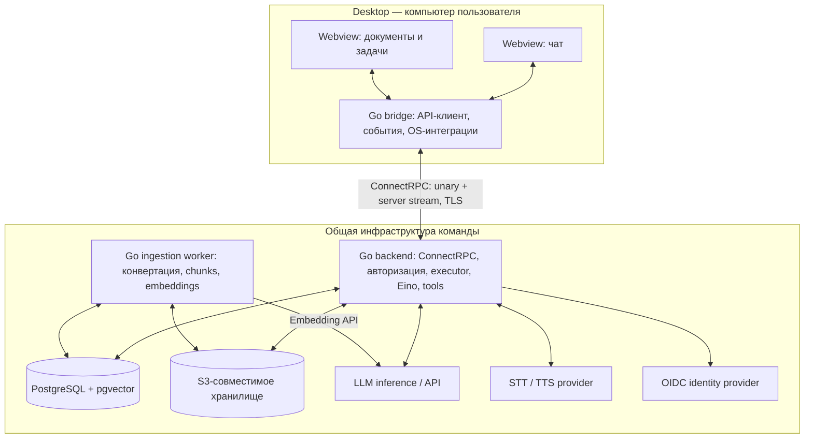
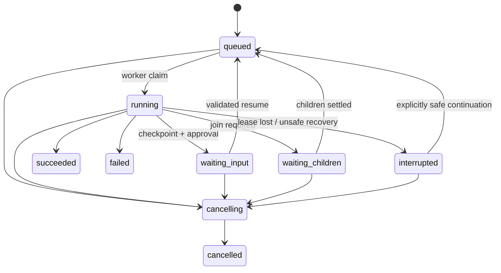

# n-projects — целевая архитектура

Дата: 6 ноября 2026. Статус: целевая архитектура с поэтапным внедрением.

**Объём первого запуска определяет [IMPLEMENTATION_PLAN.md](IMPLEMENTATION_PLAN.md): Core включает Go backend, одно окно Wails, ConnectRPC, llama.cpp, PostgreSQL и сохраняемые чаты.** Порядок этапов: **1 → 4 → 5 → 3 → 2 → 6 → 7 → 8 → 9 → 10**; исходные номера сохранены как ID. Описанные ниже функции добавляются на своих этапах. При определении ближайшего объёма работ план имеет приоритет над полной схемой этого документа.

## 1. Основания и границы решения

**Рекомендуемая архитектура: desktop-клиент на Wails, модульный Go-бэкенд, отдельный воркер обработки документов, PostgreSQL с pgvector и S3-совместимое файловое хранилище.** Eino используется внутри агентного контура. Разделение на дополнительные сервисы выполняется при появлении измеримой необходимости.

Пользователь подтвердил основной режим: **общий сервер команды и desktop-клиенты**. Локальный инференс в этом режиме означает модель в инфраструктуре сервера. Адрес `localhost` в серверной конфигурации не указывает на компьютер пользователя.

Исходные материалы имеют разный статус:

| Материал | Как используется |
|---|---|
| Запрос пользователя | Спроектировать архитектуру и план; первый результат — Core с llama.cpp и ConnectRPC, затем этапы 4, 5, 3, 2 и остальные; реализация и развёртывание ещё не поручены |
| Вложенный [AGENTS.md](docs/source/AGENTS.md) | Предлагаемые инженерные ограничения: простота, идиоматичный Go, feature-first внутри `internal`, управление окружением и командами через mise |
| Вложенный [description.md](docs/source/description.md) | Черновые продуктовые требования и технологические гипотезы, требующие согласования между собой и проверки |
| Этот документ | Конкретные проектные решения; дополнения и изменения черновика обозначены явно |

Команды Quick Start из вложения не являются отдельным поручением к исполнению. Исходные файлы не изменяются. Описанные ниже API, структуры каталогов и команды — проект будущей реализации.

Для первой командной поставки предполагается одна организация с одним рабочим пространством. `workspace_id` присутствует в данных и проверках доступа уже в Core; независимые аккаунты и роли появляются на этапе 2. Это не обещание готовой многопользовательской SaaS-платформы с биллингом и изоляцией инфраструктуры по арендаторам. Число пользователей, объём документов, целевые ОС и вычислительные ресурсы пока не заданы.

## 2. Состав системы



Embedding-модель имеет собственный профиль и может обслуживаться другим endpoint; совпадение инфраструктуры с chat-моделью необязательно.

| Единица развёртывания | Ответственность | Почему отдельна |
|---|---|---|
| `desktop` | Окна, ввод, локальные разрешения, запись и воспроизведение аудио, уведомления | Работает на компьютере пользователя |
| `server` | ConnectRPC services, RBAC, история, запуски агентов, реестр инструментов, поиск | Единая область бизнес-логики и транзакций |
| `ingest-worker` | Извлечение текста, OCR при необходимости, chunking, embeddings | Недоверенные файлы, отдельные лимиты CPU/RAM и системные зависимости |
| Inference | Chat-, embedding-, позднее speech-модели | GPU, собственный жизненный цикл и масштабирование |

Auth, registry, orchestration и RAG query — пакеты одного backend, без сетевого RPC между ними. В первой версии не нужны Kafka, Redis, Kubernetes, отдельный сервис реестра или универсальная шина команд. PostgreSQL хранит задания и события; воркеры берут работу из БД.

**Контракт desktop ↔ backend — Protobuf и ConnectRPC.** Connect handlers работают на Go `net/http`; Go bridge использует сгенерированный Go Connect-клиент. Команды выполняются unary RPC, ответы и статусы передаются server-streaming RPC. Webview обращается к локальным Wails bindings и получает Wails Events, без второго сетевого клиента в JavaScript. Отдельный REST API и SSE endpoint для чатов не требуются. Backend ↔ llama.cpp использует OpenAI-compatible HTTP API модели; это отдельная интеграционная граница.

## 3. Структура Go-проекта и правила зависимостей

Monorepo с отдельными Go-модулями для desktop и backend-сервисов. Корневой модуль содержит общий protobuf-контракт и миграции. `go.work` связывает локальные модули; `replace` на корень позволяет собирать приложения отдельно с `GOWORK=off`.

```text
n-projects/
├── apps/desktop/
│   ├── main.go
│   ├── internal/desktop/   # Wails bridge и события
│   ├── frontend/          # React + TypeScript + Vite
│   ├── build/config.yml   # Wails dev watcher
│   ├── Taskfile.yml       # минимальные задачи Wails3
│   ├── mise.toml
│   ├── Dockerfile         # экспорт Linux и Windows бинарников
│   └── go.mod
├── apps_back/server/
│   ├── cmd/server/main.go
│   ├── internal/
│   │   ├── chat/          # sessions, messages, SQL
│   │   ├── agent/         # runs, executor, отмена
│   │   │   └── engine/    # Eino TurnLoop + ChatModelAgent
│   │   └── rpc/           # Connect handlers/interceptors
│   ├── mise.toml
│   ├── Dockerfile
│   └── go.mod
├── proto/nprojects/v1/
├── gen/go/nprojects/v1/
├── migrations/            # Goose SQL, запуск из корня
├── compose.yaml           # общий запуск всех серверных сервисов
├── mise.toml              # codegen, миграции, общие проверки
├── go.work
└── go.mod                 # общий контракт и миграции
```

Новые серверные сервисы добавляются в `apps_back/<service>` со своими `go.mod`, `mise.toml` и `Dockerfile`; запускаются через общий `compose.yaml`. Пакеты identity, documents, connectors, speech и platform добавляются внутри соответствующего сервиса по мере реализации этапов.

Внутри feature-пакета достаточно `service.go`, `store.go`, `postgres.go`, `types.go` и файлов по операциям. Не создавать в каждой функции проекта одинаковые уровни `domain/application/infrastructure` или универсальные repository-интерфейсы.

Правила:

1. `cmd` и `app` собирают конкретные зависимости обычными конструкторами. DI-контейнер не нужен.
2. `rpc` вызывает прикладные сервисы и переводит Protobuf в типы приложения. SQL живёт рядом с соответствующей feature; общий пакет PostgreSQL содержит только подключение, миграции и технические helpers. Generated-код не определяет доменную модель.
3. `agent` читает контекст через небольшой интерфейс, который реализует `chat`; `chat` не импортирует исполнитель агентов. Координация стартового запроса находится в сервисе `agent` и общей транзакции.
4. `agent` объявляет небольшой контракт Engine и не импортирует `agent/engine` или `agent/scenarios`; адаптер `engine` реализует контракт и подключается в `app`. Типы Eino не входят в публичный API, схему сообщений или Wails bindings.
5. `agent/tools` задаёт контракт исполнения и не импортирует родительский пакет `agent`. Реализации регистрируются в `app`, получают `documents`/`connectors` как зависимости; `spawn_subagent` вызывает переданный callback или узкий RunStarter. Это сохраняет ацикличные импорты. Инструменты не получают произвольный доступ к БД и секретам.
6. Интерфейс вводится там, где нужен внешний адаптер, смена реализации или проверяемая граница. Предпочтительны маленькие интерфейсы со стороны потребителя; модели данных — обычные структуры.
7. Используются `context.Context`, явные ошибки, `errors.Is/As`, `log/slog`; контекст не хранится в БД. ConnectRPC на `net/http`, Protobuf, `pgx` и явный SQL достаточны для старта.

Рабочее предложение для UI — TypeScript + React + Vite, одна сборка и маршруты для разных окон. Это дополнение к черновику, а не исходное требование. Сложный state manager добавляется только при необходимости; состояние сервера и эфемерное состояние окна разделяются.

## 4. Модель предметной области

**Session — история диалога. Run — конкретное выполнение. Checkpoint — сохранённая точка продолжения.** Их нельзя объединять одним `session_id`.

| Сущность | Основные поля и назначение |
|---|---|
| Workspace / Membership | `workspace_id`, `user_id`, `role`; область доступа |
| Session | `id`, `workspace_id`, `owner_id`, `title`, `parent_session_id`, `fork_point`; ветка диалога |
| Message | `id`, `session_id`, `run_id`, `role`, `content`, `status`, `seq`; пользовательские, assistant- и tool-сообщения |
| Run | `id`, `session_id`, `parent_run_id`, `root_run_id`, `status`, `attempt`, `lease_owner`, `lease_expires_at`, `cancel_requested_at`, бюджеты, версии конфигурации |
| Checkpoint | `id`, `run_id`, `step`, `graph_version`, `state_schema_version`, `state`, ссылка на историю; неизменяемый snapshot на безопасной границе |
| ToolCall | `id`, `run_id`, `step`, `tool_name`, `tool_version`, `args_hash`, `idempotency_key`, `status`, `result_ref`; статусы `planned`, `dispatching`, `succeeded`, `failed`, `unknown` |
| Approval | `id`, `run_id`, `checkpoint_id`, необязательный `tool_call_id`, `args_hash`, `expires_at`, `status`, решение пользователя |
| RunEvent | `run_id`, монотонный `seq`, `type`, `schema_version`, `payload`, `created_at`; журнал доставки UI |
| Document / DocumentVersion | права, исходный object key, hash, media type, статус и версии extraction/embedding |
| Chunk | `document_version_id`, `ordinal`, `text`, `location`, embedding; пригоден для цитирования |
| IngestionJob | `document_version_id`, `status`, lease, попытки, ошибка; долговечная очередь обработки |
| AuditEvent | actor, действие, ресурс, результат, время, trace ID; отдельный журнал действий |

Крупные файлы и результаты инструментов находятся в object storage. PostgreSQL хранит их идентификаторы, метаданные и права. Checkpoint не включает открытые соединения, goroutine, stream reader, `context`, ключи доступа или весь бинарный файл.

Ограничения БД:

- Не более одного незавершённого **корневого** run в сессии; дочерние run разрешены. Ожидание подтверждения также занимает этот слот. Для независимой работы создаётся fork.
- `UNIQUE(run_id, seq)` для событий; `UNIQUE(run_id, logical_tool_call_key)` для логического вызова инструмента.
- `request_id` изменяющего RPC уникален в пределах пользователя, workspace и метода. Другой payload с тем же ключом даёт Connect `AlreadyExists`.
- Документ, сессия, run и ссылки между ними проверяются на принадлежность рабочему пространству; при необходимости используются составные внешние ключи.
- Версии сообщений, используемые checkpoint/fork, неизменяемы. Редактирование старого сообщения создаёт новую ветку.

## 5. Выполнение запроса и состояние run

Контур развивается в порядке Core → долговечное выполнение (этап 4) → субагенты (5) → общий tool registry (3) → командная авторизация (2). До registry исполняются встроенные типизированные шаги, до OIDC используется dev identity с проверкой actor/ownership. Ниже показано целевое состояние, которое наращивается по этим этапам.



Истечение ожидания, отказ пользователя и превышение бюджета также могут завершить run как `failed` с отдельным reason code; сценарий может обработать отказ как обычный результат и продолжить. Терминальные состояния: `succeeded`, `failed`, `cancelled`.

Обычный запрос:

1. Connect interceptor и application service проверяют пользователя, workspace, доступ к сессии, квоты и `request_id`.
2. Одна транзакция добавляет сообщение пользователя, создаёт `Run(status=queued)` и первое событие. Unary `StartRun` возвращает `StartRunResponse` с `run_id` и текущим статусом. Эта схема очереди появляется на этапе 4; Core запускает принятый run в ограниченном локальном executor.
3. Executor выбирает run из PostgreSQL короткой транзакцией с `FOR UPDATE SKIP LOCKED`, устанавливает lease и освобождает транзакцию. Сеть и модель никогда не вызываются при удержании SQL-lock.
4. Собирается ограниченный контекст: история/summary, разрешённые документы, выбранные tools, параметры модели и лимиты. Версии графа и набора tools фиксируются в run.
5. Eino исполняет граф; адаптер переводит его callbacks и stream-элементы в события приложения. Вызов инструмента проходит через единый dispatcher.
6. На безопасных границах сохраняются результаты и checkpoint; по окончании assistant-message и терминальное событие фиксируются согласованно.

У каждого run есть лимит времени, шагов, входных/выходных токенов, tool calls, глубины дерева и числа параллельных детей. Начальные значения выбираются после пилотного замера и задаются конфигурацией. Бюджет корневого run общий для дерева; дочерняя задача не создаёт новый неограниченный бюджет.

В начальной поставке работает один backend-процесс с ограниченным пулом исполнения. На этапе 4 добавляются lease и `attempt` для возобновления выполнения после перезапуска; в Core незавершённые runs отмечаются прерванными без автоматического resume. Heartbeat продлевает lease; каждый переход состояния проверяет актуальный owner/attempt. При потере владения старый executor прекращает работу. Это защищает записи в БД, но само по себе не останавливает уже отправленный внешний запрос.

### Subagents

Каждый субагент — отдельный дочерний Run, запускающий ограниченный Eino subgraph через тот же executor. `spawn_subagent` имеет стабильный ключ, чтобы восстановление родителя не создало дубликат. Родитель хранит child IDs и ссылки на результаты, а не сериализует дерево goroutine.

Родитель, ожидающий детей, освобождает слот исполнения (`waiting_children`), иначе маленький worker pool может взаимно заблокироваться. Постановка ожидания и завершение детей используют одну блокировку строки родителя: под ней повторно проверяется условие join. Если дети уже закончили, родитель сразу возвращается в очередь; иначе последний ребёнок пробуждает ожидающего родителя. Так завершение ребёнка перед записью `waiting_children` не теряется.

Субагенту передаются задача, разрешённый срез контекста и подмножество tools; права не расширяются. Его внутренний transcript привязан к child run и не попадает автоматически в историю Session или prompt родителя. Родитель получает явно выбранный итог и ссылки на артефакты; подробности доступны в дереве выполнения по правам. Ошибка ребёнка обрабатывается заданной политикой сценария: остановка дерева или частичный результат.

Создание ребёнка, резервирование общего бюджета и отмена поддерева сериализуются короткой блокировкой корневого Run, с проверкой отмены у всех предков. Только после этого вставляется дочерний run. Проверки флага вне этой транзакции недостаточно: иначе ребёнок может появиться после отмены родителя.

## 6. Checkpoint, подтверждение и fork

Eino — механизм исполнения графа, а не полная система долговечных задач. Поддержку pause/resume нужно проверить на выбранной версии и конкретном графе. Собственное состояние приложения хранится независимо от внутренних объектов библиотеки; framework checkpoint может храниться рядом как версионированный payload. Вместе с ним сохраняется версия Eino.

### Human-in-the-loop

1. Dispatcher подготавливает конкретный вызов и проверяет policy.
2. Если требуется решение человека, сохраняет tool intent, checkpoint, Approval и `waiting_input`; после commit отправляет событие. Внешнее действие ещё не выполняется.
3. Ожидание не удерживает goroutine, SQL-транзакцию или worker slot.
4. Ответ адресуется `run_id + approval_id`, проверяет текущие права, состояние, срок и hash фактических аргументов, версии инструмента и целевого ресурса, если ресурс изменяемый.
5. Одноразовое принятие ответа и возврат run в очередь выполняются атомарно. Повтор того же запроса возвращает прежний результат; конкурирующий ответ даёт конфликт.
6. Перед действием dispatcher повторно проверяет права. Изменённые аргументы требуют нового подтверждения.

Атомарность не возникает автоматически из callbacks Eino. Адаптер сначала получает полный сериализованный checkpoint после остановки графа и сохраняет его как staged payload. Затем короткая SQL-транзакция публикует ссылку на него вместе с tool intent, Approval, статусом и событием. При возможности payload записывается прямо в этой транзакции. Неопубликованный checkpoint не виден resume и удаляется как orphan; незавершённое ожидание восстанавливается с предыдущей безопасной границы. SQL-транзакция не держится через Eino Invoke или ожидание внешнего API. Этот протокол — обязательный результат технического прототипа Eino.

Произвольный текст пользователя и разрешение на внешнее действие — разные варианты ожидания с разными схемами payload. Отказ и истечение срока имеют явную ветку сценария. Вложенное подтверждение привязано к дочернему run; UI показывает всю цепочку.

### Восстановление после сбоя

Долговечные задания имеют семантику at-least-once. Обещание «ровно один внешний эффект» возможно только при поддержке идемпотентности или проверяемого результата у конкретной интеграции.

| Где произошёл сбой | Поведение |
|---|---|
| ToolCall ещё `planned`, dispatch не начинался | Безопасно начать после claim и повторной проверки прав |
| После read-only операции | Повторить по ограниченной retry-политике, если результат ещё не сохранён |
| Во время генерации | Сохранить неполный ответ как incomplete; новую генерацию обозначить новым attempt/revision |
| После внешнего изменения, до записи результата | `ToolCall=unknown`, run `interrupted`; проверить удалённый результат по ключу/ID или запросить решение оператора |
| Во время ожидания пользователя | Загрузить Approval и checkpoint; ожидание продолжает существовать |
| Версия графа/checkpoint несовместима | Не продолжать автоматически; миграция состояния либо новая ветка из истории |

Перед отправкой изменяющего вызова сохраняется intent и стабильный idempotency key, затем транзакционно фиксируется `dispatching`. После сбоя любой незавершённый `dispatching` консервативно считается `unknown`, даже если запрос фактически ещё не успел покинуть процесс. Таймаут не доказывает, что действие не произошло. Автоматический retry такого вызова допускается только при проверенном контракте идемпотентности/сверки результата интеграции. История диалога переживает обновление Eino даже тогда, когда старый runtime-checkpoint восстановить нельзя.

### Fork

Два явно разных сценария:

- **Fork диалога:** новая Session из неизменяемого префикса истории и ссылок на доступные документы. Старые tool outputs становятся историческим контекстом и не выполняются повторно.
- **Fork выполнения:** новая Session и Run из совместимого checkpoint. Переносятся только сериализуемое состояние и результаты завершённых шагов; незавершённые внешние действия автоматически не дублируются. Прежние approvals не дают разрешения новой ветке.

При реализации fork на этапе 4 поддерживаются сохранённые безопасные границы: завершённый логический ход, завершённый узел или ожидание пользователя, если эта точка поддержана адаптером Eino. «С произвольного шага» из черновика уточняется именно так: разветвление из произвольного машинного состояния внутри HTTP-вызова или генерации не обещается. После fork права на документы проверяются заново.

## 7. Stop и отключение клиента

Контекст исполнения создаётся от lifecycle executor, а не от контекста unary RPC или подписки `WatchRun`. Закрытие окна, отмена stream и обрыв сети не отменяют задачу на общем сервере.

Unary RPC `RunService.CancelRun` идемпотентно сохраняет `cancel_requested_at` для run и его незавершённого поддерева, сериализуясь со spawn под блокировкой корневого run. Все переходы и создание новых детей проверяют этот флаг. Pending approvals аннулируются в согласованной транзакции; конкурирующий resume не обходит отмену. Затем процесс сигнализирует локальному `CancelFunc`; после рестарта флаг остаётся в БД. Проверка флага/lease по таймеру нужна даже при использовании быстрого локального сигнала.

Queued/ожидающие runs без активного исполнителя завершаются координатором отмены; для родителя учитывается остановка поддерева. Периодический reconciler завершает застрявшие переходы после сбоя, поэтому отмена не требует существования живой goroutine для каждого run.

Отмена проходит через Eino, HTTP-клиенты, model adapters, очередь tool calls и дочерние run. Stream readers закрываются владельцем; закрытие каналов имеет одного ответственного. Для конвертеров используются timeout, process-group termination и лимиты контейнера: один `exec.CommandContext` не гарантирует остановку всех потомков.

UI получает подтверждение запроса Stop сразу и отображает `cancelling`, пока выполняется завершение. Новые tools больше не стартуют; в `cancelled` фиксируется остановка локального исполнения. Уже завершённые внешние действия не откатываются. Неподтверждённый исход внешнего вызова остаётся `unknown` и виден пользователю даже после отмены.

Хоткей паузы TTS немедленно останавливает локальное воспроизведение, затем отменяет загрузку/синтез; его не нужно связывать с отменой всего агентного run.

## 8. Desktop, окна и поток событий

Go bridge предоставляет Webview небольшое прикладное API: отправить сообщение, открыть документ, остановить run, ответить на approval. Токены доступа находятся в Go-слое и OS keychain, не в `localStorage`.

Ниже описан целевой поток с durable events этапа 4 и несколькими окнами этапа 8. Core использует одно окно и Connect server stream `WatchRun` со снимками текущего сообщения, сохранённой revision и восстановлением актуального snapshot; replay полного журнала в нём не требуется.

Каждое окно имеет собственный frontend store. Go bridge держит подписку на сервер, маршрутизирует события по `session_id/run_id` и отправляет их через Wails Events. Источник истины — сервер; Wails Event Bus обеспечивает только локальную доставку и не восстанавливает пропущенные события.

На этапе 4 `WatchRunRequest` получает явный `after_seq`. При первой подписке сервер отправляет согласованный `RunSnapshot` с cursor и затем события новее cursor; при reconnect клиент передаёт последний применённый `seq`, сервер воспроизводит сохранённые события. Повтор отбрасывается по `(run_id, seq)`. Если cursor старше retention, stream присылает новый snapshot с признаком reset, клиент заменяет состояние и продолжает с его cursor. Snapshot и cursor соответствуют одной версии данных. Это протокол приложения поверх ConnectRPC: reconnect, replay и дедупликацию реализуют сервер и Go bridge.

Серверные текстовые дельты объединяются в ограниченные блоки, например каждые 100–250 мс. Каждый батч, обновление `Message.content/applied_seq` и соответствующий `run_events` записываются одной транзакцией, и только после commit отправляются клиенту. Так snapshot не возвращает cursor новее представленного текста. Терминальные события, approvals и tool outcomes также долговечны. После сбоя показывается уже сохранённый неполный ответ. Точные интервалы и стоимость обновления больших сообщений определяются по нагрузке; альтернативная проекция допустима только с восстановлением snapshot строго до заявленного cursor.

`WatchRunResponse` содержит Protobuf `oneof`: snapshot либо event. `RunEvent` содержит `run_id`, `seq`, версию payload и типизированный `oneof` события. Основные варианты: изменение статуса run, текстовая дельта, завершение сообщения, начало/окончание операции, запрос подтверждения, создание дочернего run и завершение задачи. Содержимое и аргументы инструментов фильтруются по правам и чувствительности. Новые варианты добавляются совместимо; существующие номера полей не переиспользуются.

Очереди отправки и UI-буферы ограничены. Медленный клиент переподключается и дочитывает журнал; исполнение агента не ждёт отрисовки Webview. Обновления текста объединяются перед render. При завершении фоновой задачи Go bridge показывает уведомление без дублирования между окнами. Закрытое desktop-приложение не получает OS notification без отдельного фонового компонента; в v1 результат обнаруживается при следующем подключении.

Панель выполнения отображает план, этапы, выбранные инструменты, результаты и краткие пояснения. Упоминание `thought chain` в черновике заменяется этим контрактом: внутренние рассуждения модели не являются обязательными данными API или аудита.

## 9. ConnectRPC-контракт

Источник контракта — Protobuf package `nprojects.v1` в `proto/nprojects/v1`. protoc и закреплённые plugins генерируют Go messages, Connect handlers и Go-клиент. `mise run generate` воспроизводит код, `mise run proto:check` проверяет воспроизводимость generated-кода. Для внутренних команд не поддерживается параллельный REST/OpenAPI-контракт.

| Service.Method | Вид | Назначение и этап |
|---|---|---|
| `SessionService.CreateSession/ListSessions/GetSession` | Unary | Создание, список и метаданные чатов; Core |
| `SessionService.UpdateSession/DeleteSession` | Unary | Переименование и удаление; Core |
| `SessionService.ListMessages` | Unary | История с cursor pagination; Core |
| `RunService.StartRun` | Unary | Сообщение и запуск run; Core, durable queue на этапе 4 |
| `RunService.GetRun` | Unary | Snapshot состояния; Core, далее дерево и approvals |
| `RunService.WatchRun` | Server stream | Snapshots в Core; durable events и `after_seq` на этапе 4 |
| `RunService.CancelRun` | Unary | Отмена run; после этапа 5 — также поддерева |
| `RunService.RespondToApproval` | Unary | `run_id + approval_id`, одноразовый ответ и resume; этап 4 |
| `SessionService.ForkSession` | Unary | Fork по безопасному `message_id` либо `checkpoint_id`; этап 4 |
| `DocumentService.BeginUpload/CompleteUpload` | Unary | Выдать ограниченный upload URL, проверить объект и создать ingestion job; этап 6 |
| `DocumentService.GetDocument/GetDocumentContent` | Unary | Статус и ограниченный диапазон текста/preview; этап 6 |

Изменяющие RPC включают `request_id`: повтор с тем же payload возвращает прежний результат, повтор ключа с другим payload даёт `AlreadyExists`. Неактуальное состояние даёт `FailedPrecondition`, неверные аргументы — `InvalidArgument`, заполненные execution slots — `ResourceExhausted`, недоступность сервиса — `Unavailable`. Авторизация использует `Unauthenticated`/`PermissionDenied` с безопасными сообщениями; политика сокрытия чужого объекта может возвращать `NotFound`. `request_id` идемпотентности не заменяет correlation/trace ID конкретной попытки запроса.

Доменная ошибка уже принятого run сохраняется в его состоянии и приходит в snapshot/event; обрыв RPC обозначает ошибку доставки и сам по себе не доказывает неуспех run. После неоднозначного результата `StartRun` клиент повторяет запрос с прежним `request_id` или читает известный run, не создавая новую задачу автоматически.

Connect interceptors проверяют identity, metadata и общие ограничения; application services проверяют конкретные ресурсы и операции. Сервер не доверяет `user_id`, роли и `workspace_id` из payload без проверки. Проверки относятся к unary, server stream, tools и download. Длительные подписки прекращают доставку при отзыве доступа. Deadline unary RPC и cancellation `WatchRun` не являются сроком жизни run; пользовательский Stop вызывает `CancelRun`.

Удалённый Connect-трафик идёт по TLS. Reverse proxy должен пропускать потоковые ответы без накопления всего тела и с подходящими таймаутами. Крупные бинарные файлы передаются по ограниченным подписанным HTTPS URL object storage; управление загрузкой и доступом остаётся в ConnectRPC. Это не требует упаковывать весь файл в один Protobuf unary request.

## 10. Tools, skills и сценарии

**Tool** — исполнимая операция с валидируемой схемой. **Skill** — версионированное описание поведения, инструкций и допустимых инструментов. **Scenario** — заранее описанный многошаговый workflow/Eino graph. Эти понятия связаны, но не взаимозаменяемы.

Registry добавляется на этапе 3 после готовых этапов 4 и 5; он собирается из кода и проверенных файлов manifest при старте сервера. Это центральный каталог внутри процесса, а не отдельный сервис или загрузчик произвольных Go plugins. Manifest содержит имя, версию, schema, read/write-класс, требуемые разрешения, timeout, ограничения и политику подтверждения. Scenarios и skills входят в версионированный релиз; пользовательский marketplace откладывается.

На этапе 4 внутренний контракт исполнения и ledger проверяются встроенным сценарием и контролируемым адаптером внешнего эффекта. На этапе 5 `spawn_subagent` подключается как фиксированная операция Eino с собственной схемой; сценарии используют встроенные шаги и LLM. На этапе 3 registry оборачивает эти реализации и добавляет skills, произвольный набор tools и первый domain connector. Единственный механизм исполнения, approval и восстановления сохраняется; ранние этапы не требуют готового каталога.

Dispatcher для каждого вызова выполняет: schema validation → authorization → quota/budget check → approval, если требуется → сохранение intent → исполнение → запись результата/audit. Фильтрация списка tools перед моделью уменьшает контекст, но не заменяет повторную проверку при исполнении. Модель не может назначить себе права, поменяв аргументы.

Базовые tools:

- `read_document(document_id, version_id, range)` — чтение загруженного документа с ACL. Если оставить имя `read_file`, его контракт всё равно использует ID артефакта, а не путь сервера.
- `rag_search(query, collection_ids, filters)` — поиск только в разрешённых источниках, возврат chunk IDs и координат цитат.
- `spawn_subagent(task, context_refs, budget)` — дочерний run в рамках прав и бюджета родителя.
- Domain tools — адаптеры конкретных интеграций с явными режимами чтения и изменения.

Доступ к файлам компьютера пользователя выполняется через file picker и явную загрузку из Go bridge. Удалённый backend не читает произвольный локальный путь. Для будущего редактирования кода понадобится отдельный workspace runner с изоляцией, checkout, diff и политикой записи; пример «рефакторинг модуля» из черновика не покрывается одним `read_file` и относится к последующей очереди.

Текст документов, tool outputs и сторонних skills считается данными. Он не получает полномочий менять системные правила, раскрывать секреты или расширять список доступных операций.

## 11. Документы и RAG

```text
Desktop file picker
  → проверка upload policy → S3 original
  → complete: проверка объекта + PostgreSQL job
  → worker: MIME detection → extractor → normalized text + location map
  → chunking → embedding → staging index
  → атомарная публикация document version как ready
  → authorized retrieval → context с цитатами → ответ
```

Загрузка и обработка асинхронны. Незавершённые uploads удаляются по TTL. Ключ object storage генерирует сервер; завершение загрузки проверяет владельца, размер, checksum и реальный тип. Имя файла само по себе не определяет формат.

| Формат | Маршрут извлечения |
|---|---|
| DOCX, RTF, HTML, EPUB | Pandoc соответствующей закреплённой версии; удаление активного/небезопасного HTML при preview |
| PDF с текстом | Специализированный PDF extractor; сохраняются номера страниц |
| Сканированный PDF | OCR с явным языком, лимитами и статусом качества; отдельная возможность этапа внедрения |
| XLSX | Spreadsheet-aware extraction с именами листов и координатами; Pandoc допустим, если закреплённый reader сохраняет нужную структуру |

Pandoc остаётся основным конвертером, но не универсальным входом для всех форматов. Для таблиц важно определить представление формул и cached values, пустых ячеек, merged cells и больших листов. OCR и отсутствие текста не маскируются статусом успешной обработки.

Worker запускает конвертеры без shell-интерполяции, с фиксированными аргументами, без пользовательских фильтров и загрузки внешних ресурсов. Изоляция: непривилегированный пользователь, временный каталог, ограниченные сеть, CPU/RAM, число страниц, распакованный размер архивов, время и размер вывода. Read-only root filesystem и отдельный scratch-volume уменьшают последствия ошибки парсера.

Нормализация сохраняет заголовки, таблицы и `location`: страница/раздел/лист/ячейки. Chunking учитывает структуру; простой фиксированный размер с overlap допустим как старт, но не должен разрывать таблицы без координат. Для каждой версии сохраняются content hash, extractor/version, chunking version, embedding model/version/dimension.

На этапе RAG используется **pgvector в общей PostgreSQL**; Core использует PostgreSQL без векторного расширения. Это упрощает ACL и транзакционную публикацию индекса. Qdrant имеет смысл после измерения объёма, задержки поиска и влияния векторов на основную БД. При необходимости добавляется PostgreSQL full-text search для гибридного поиска.

Retrieval фильтрует права **в запросе до отбора результата и отправки в LLM**; post-filter после глобального top-k недостаточен. Для ANN проверяются recall при ACL-фильтрах и подходящий индекс; для малых коллекций допустим точный поиск. Ответ содержит ссылки на конкретные document versions и chunks. Исходный документ доступен по авторизованному endpoint, без постоянного публичного URL.

Индексация идемпотентна по версии документа и версии pipeline. Неполный индекс не участвует в поиске. Замена embedding-модели создаёт новый индекс/версию, особенно при другой размерности; после проверки выполняется переключение. Удаление документа немедленно закрывает доступ и исключает chunks из retrieval, затем очищает blob, производные данные и индексы с учётом retention и истории ссылок.

## 12. Модели, Eino и голос

Для Core пользователь выбрал **llama.cpp**: backend обращается к отдельному `llama-server` через OpenAI-compatible API, используется один проверенный GGUF-профиль. Другие serving runtimes и провайдеры — последующие расширения; они не являются условием запуска Core.

Профиль chat-модели задаёт provider, endpoint, model ID, context limit, sampling, timeout и проверенные capabilities. API-совместимость с OpenAI не означает совместимость tool calling, streaming, usage и cancellation во всех деталях.

Eino получает адаптер модели; новый собственный adapter нужен только при отсутствии подходящего поддерживаемого компонента. Для проверенной версии Eino v0.9.22 используется `model.ToolCallingChatModel.WithTools`: список разрешённых инструментов задаётся отдельному варианту модели на run. Устаревший `model.ChatModel.BindTools` меняет общий экземпляр и не подходит для конкурентных runs с разными permissions. Реальные интерфейсы tools — `tool.BaseTool`, `tool.InvokableTool`, `tool.StreamableTool`, а не `eino.Tool` из черновика.

Registry моделей фиксирует поддержку tool calling, параллельных вызовов, structured output и ограничения провайдера. Доступность исходного кода модели не доказывает пригодность выбранной квантовки и serving backend.

Gemma 4 из черновика остаётся кандидатом baseline, а не жёсткой зависимостью доменной модели. Её существование подтверждено; обозначение «12B+» не является точным model ID. Финальная конфигурация выбирается после проверки лицензии, памяти, русского языка, инструментов и измерения на целевой GPU. Фиксируются revision весов, tokenizer/chat template и serving runtime. Chat и embeddings могут использовать разные модели. Summary истории сохраняет ссылки на исходные сообщения и не заменяет историю.

Название сессии создаётся после первого сообщения пользователя асинхронно в небольшом пуле низкого приоритета. Это производные данные: ошибка генерации названия не мешает run и допускает повтор. Условное обновление не перезаписывает название, заданное пользователем. Для этой операции достаточно простой модели/lambda; отдельный сервис не нужен.

Для речи первая реализация — push-to-talk: MediaRecorder → ограниченные аудиочанки → Go bridge → backend/STT → редактируемый текст перед отправкой. Форматы Webview (`webm/opus`, `ogg`, `wav`) согласуются через capability detection и при необходимости серверную транскодировку. Способ передачи бинарных данных через выбранный Wails bridge проверяется прототипом; если binding сериализует их в base64, задаются небольшие лимиты чанков и измеряется накладная стоимость. Длительная запись не накапливается целиком в JSON.

TTS синтезирует ответ сегментами, воспроизведение контролируется клиентом. Backend хранит только необходимые метаданные; сохранение аудио по умолчанию выключено. Полный duplex, barge-in и realtime voice требуют отдельного протокола, например WebSocket, и добавляются после текстового контура. В v1 STT/TTS — адаптеры и задания, отдельный speech-сервис появляется при собственной GPU-нагрузке или необходимости масштабирования.

## 13. Авторизация, аудит и наблюдаемость

Для командного сервера на этапе 2 добавляются OIDC Authorization Code + PKCE и системный браузер. До этого этапы 1, 4, 5 и 3 работают с bootstrap identity в явно отделённой dev-конфигурации; подтверждения принадлежат этому пользователю. Desktop — public client без встроенного client secret. Backend проверяет issuer/audience/signature/expiry и получает текущую membership из БД; Connect interceptors устанавливают identity, прикладная policy проверяет доступ к ресурсам и действиям.

| Роль | Основные возможности |
|---|---|
| Admin | Пользователи, настройки интеграций и политики; доступ к данным задаётся явно, а не подразумевается одной ролью |
| Member | Запуск агентов, загрузка разрешённых документов, работа со своими/расшаренными сессиями |
| Read-only | Просмотр доступных сессий и документов; без запуска, upload, fork, cancel и approvals |

RBAC дополняется проверкой конкретного ресурса: workspace, владелец, sharing, разрешённые интеграции. Подтверждать действие может инициатор либо назначенный approver согласно policy. При добавлении командного доступа проверяется весь уже готовый контур: tools, children, checkpoint/fork, pending approvals и активные `WatchRun`-подписки. Источники для ответа в общем чате должны быть доступны его аудитории; sharing проверяет ссылки на приватные материалы. API-ключи провайдеров хранятся на сервере через secret manager или защищённую runtime-конфигурацию; токены пользователя — в OS keychain. Секреты не попадают в LLM prompt, manifest, audit payload или Connect stream.

`slog` пишет структурированные журналы. OpenTelemetry связывает попытку RPC, run, graph/node, tool, provider request и ingestion job. Eino callbacks используются для инструментирования, но не считаются источником истины состояния run.

Метрики: длина/время очереди, TTFT, время первого UI-фрагмента, длительность run и tools, токены и стоимость при наличии usage, ошибки/таймауты, число paused/interrupted runs, задержка Stop, ingestion throughput и поиск. Trace/span содержит ID и безопасные атрибуты; полные prompts и документы по умолчанию не записываются. Отладочный захват содержимого — отдельная настройка с ограничением доступа и срока хранения.

Audit фиксирует входы, изменения прав, загрузки, fork, approvals, попытки tool calls, результаты действий и операции с секретами без их значений. Retention run events, истории, документов, trace и audit задаётся раздельно; удаление сессии учитывает дубликаты текста в событиях и производных объектах. Требования к юридически неизменяемому аудиту пока не заявлены.

## 14. Окружение, mise и эксплуатация

Mise — единая точка входа для разработчика и CI. Каждый backend-сервис имеет собственный mise.toml с закреплёнными инструментами. Desktop имеет собственный mise.toml с Go `latest`, Node `latest` и Wails3 CLI `v3.0.0`, устанавливаемым через Go backend mise. Go-библиотеки фиксируются в `go.mod/go.sum`, frontend — в lockfile, Wails fork — тегом или commit/pseudo-version. `mise` не заменяет package manager и production supervisor.

Команды mise (общие — из корня, приложения — из своего каталога):

| Команда | Назначение |
|---|---|
| `mise install` | Установка инструментов выбранного приложения |
| `mise run build` из `apps_back/server` | Отдельная сборка backend-образа |
| `mise run compose:up` | Запуск backend и PostgreSQL из готовых образов |
| `mise run migrate` | Goose: явное применение SQL из migrations/ |
| `mise run generate` / `proto:check` | protoc codegen и проверка воспроизводимости generated-кода |
| `docker compose --env-file .env -f compose.yaml down` | Остановка контейнеров с сохранением данных |
| `mise run fmt` / `lint` / `test` | Форматирование и согласованные проверки |
| Wails desktop | Отдельный нативный клиент, подключаемый к backend |

В desktop минимальный Taskfile обслуживает `wails3 build` и dev watcher; mise остаётся внешней точкой входа: `doctor`, `dev`, `production`. Для Linux WebKitGTK и других OS SDK, которые нельзя поставить обычным mise backend, используется штатный пакетный менеджер ОС для сборки отдельного desktop-клиента; ограничения mise не скрываются.

Dev-инфраструктура — Docker Compose. В Core запускаются backend, PostgreSQL, llama-server и desktop; inference может быть внешним процессом. На этапе 6 добавляются `ingest-worker` и object storage, а полный набор команд выше отражает целевой состав. У production ingestion worker свои лимиты и сетевой профиль. Desktop собирается в CI через Dockerfile для Linux и Windows amd64. Linux использует динамическую линковку GTK4/WebKitGTK. Подпись и обновление — отдельные будущие задачи.

При SIGTERM backend прекращает приём новых jobs, завершает или безопасно прерывает активные runs, сохраняет состояние и освобождает ресурсы. Ожидающие подтверждения runs остаются в БД. Миграции выполняются отдельной операцией перед запуском версии; обновление графов не должно незаметно делать pending checkpoints нечитаемыми.

Резервное копирование включает PostgreSQL и object storage. Проверяется восстановление согласованных ссылок и файлов. Обновление и откат приложения учитывают версию схемы БД и checkpoint. Для минимальной установки один backend означает отсутствие HA; это осознанная граница первой версии.

## 15. Порядок реализации и критерии готовности

Подробный объём каждого этапа, исключения, зависимости и критерии приёмки находятся в [плане реализации](IMPLEMENTATION_PLAN.md).

| Этап | Добавляемый результат |
|---|---|
| 1. Core | Go backend, один Wails Webview, ConnectRPC, llama.cpp, PostgreSQL, чаты, streaming, Stop |
| 4. Долговечное выполнение | Queue/lease, checkpoints, HITL, resume, durable events, fork, внутренний контракт исполнения |
| 5. Субагенты и сценарии | Дерево задач, встроенный spawn, budgets/join, workflows |
| 3. Инструменты и skills | Общий registry, schemas, tool loop, skills, первый domain connector |
| 2. Командный доступ | OIDC, роли, владение и sharing для всех реализованных функций |
| 6. Документы | S3, ingestion worker, конвертация, OCR, чтение документов |
| 7. RAG | Embeddings, pgvector, retrieval и цитаты |
| 8. Рабочая область desktop | Multi-Webview, канбан, уведомления, улучшение чатов |
| 9. Голос | STT, push-to-talk, TTS и хоткей паузы |
| 10. Релиз для эксплуатации | Packaging, backup/restore, наблюдаемость и нагрузочные проверки |

Номера сохранены как идентификаторы, порядок строк соответствует реализации: **1 → 4 → 5 → 3 → 2 → 6 → 7 → 8 → 9 → 10**. Технические прототипы выполняются внутри соответствующих этапов. Реализация Core не ожидает проверки всех будущих подсистем.

Целевые критерии, которые следует закрепить по итогам прототипа: задержка видимой реакции Stop, верхняя граница server-side cancellation для управляемых адаптеров, TTFT на выбранной модели, параллелизм, размер документов и время индексации. Числа без сведений о GPU, ОС и нагрузке здесь не выдаются за гарантии.

Наиболее ценные проверки реализации:

- интеграционные тесты транзакций, lease и идемпотентности с настоящей PostgreSQL;
- отказ между внешним эффектом и commit, истёкший lease и старый worker;
- restart/reconnect с частичным текстом, approval и дочерними runs;
- завершение ребёнка до постановки join, одновременные spawn/cancel и общий бюджет дерева;
- cancellation, закрытие streams и отсутствие утечек goroutine, включая `go test -race` для конкурентного кода;
- Connect unary/server-stream через generated Go-клиент, reconnect/cursor replay и раздельная отмена подписки/задачи;
- недоступность чужих sessions/documents через RPC, stream, object download и RAG;
- fixtures конвертации и UI smoke tests двух независимых окон на каждой целевой ОС;
- небольшой набор прикладных задач для модели: русский язык, корректность tool arguments, цитаты и устойчивость к инструкциям в документах.

## 16. Когда усложнять архитектуру

| Измеримая причина | Следующий шаг |
|---|---|
| Agent execution увеличивает задержку RPC или нужен независимый deploy | Выделить `apps_back/agent-worker`, оставив текущие доменные пакеты и PostgreSQL queue |
| Ingestion упирается в CPU/OCR | Добавить экземпляры ingestion worker с тем же контрактом lease |
| Inference упирается в GPU/очередь | Масштабировать serving и разделить профили chat/embedding/speech |
| Векторный индекс заметно ухудшает работу основной БД | Оценить отдельный vector store на реальных запросах и ACL |
| Нужны несколько backend API replicas и высокая частота fan-out | Сначала доставка через DB polling/notification; broker — после измерений, durable event log остаётся источником replay |
| Нужна работа с исходниками на компьютере пользователя | Отдельно спроектировать client/workspace runner и протокол локальных полномочий |

До появления этих условий дополнительные сервисы увеличивают число сетевых отказов и стоимость эксплуатации, не добавляя нужной функциональности.

## 17. Решения, оставшиеся для старта разработки

Эти уточнения не мешают выбрать архитектуру, но влияют на реализацию и размер первого релиза:

1. Целевые ОС и требование к Webview: достаточно независимых окон/JS-контекстов или обязательна изоляция cookies, storage и browser profiles?
2. Число активных пользователей, одновременных runs, объём/размер документов, целевая GPU и допустимая передача данных внешним model providers.
3. Корпоративный IdP, правила sharing документов и сессий, хранение истории, исходных файлов и аудита.
4. Какой domain connector выбрать для этапа 3? Этап 5 начинает со сценария анализа предоставленного текста двумя субагентами без внешней интеграции. OCR реализуется на этапе 6, кодовые workspace вынесены в отдельное расширение.
5. Должны ли уведомления приходить при полностью закрытом desktop и нужен ли офлайн-режим? В базовом решении этого нет.

Архитектура предусматривает функциональное ядро черновика с поэтапным внедрением. Первый результат — Core из плана; fork добавляется по безопасным сохранённым точкам, локальные файлы — через пользовательскую загрузку, речь — отдельным этапом, изменения кода — через будущий workspace runner.

## Приложение A. Проверка технологических предпосылок

Проверено 6 ноября 2026 года по официальным репозиториям и публикациям. Это проверка документации и исходного кода; сборка приложения, испытание форка Wails на ОС и запуск моделей не выполнялись. Обновление зависимостей требует повторной проверки совместимости.

| Предпосылка черновика | Что подтверждено | Решение |
|---|---|---|
| Go 1.27.3+ | Официальный список релизов возвращает `go1.27.3`, `stable: true` [1] | Начальная фиксированная версия `1.27.3`; обновлять patch осознанно |
| Piloswine1/wails, несколько контекстов | Есть несколько `WebviewWindow` и отдельные WebView; полная изоляция browser storage не доказана [2–4] | Закрепить commit, проверить два окна и нужную изоляцию на целевых ОС |
| Eino Graph, инструменты, checkpoint | Подтверждена v0.9.22; имеются model/tool interfaces и checkpoint API [5–8] | Закрепить Eino и совместимые модули `eino-ext`; не смешивать `compose` и ADK interrupt API |
| Pandoc для всех форматов | Pandoc 3.13 читает DOCX/RTF/HTML/EPUB/XLSX, но PDF не указан среди input readers [9–10] | PDF extractor отдельно; XLSX через Pandoc или специализированный parser по требованиям к структуре |
| Gemma 4 (12B+) | Официальный код перечисляет E2B, E4B, 26B_A4B и 31B; точный Gemma 4 12B в нём не найден [11–12] | Уточнить model ID и аппаратный профиль; номинальные и активные параметры MoE не смешивать |

**Особенности подключения Wails.** Проверенный commit форка: `1d1c0c36d0bc855eaf45d27cbb5bf1a897f9ab34`. В `v3/go.mod` сохранён module path `github.com/wailsapp/wails/v3`, указан `go 1.26.0` и toolchain `go1.26.10`. Для приложения на Go 1.27.3 нужна проверка сборки. Форк подключается корректным `replace` на закреплённую ревизию с учётом каталога `v3`; импорты приложения следуют объявленному module path. Наличие tag `v3.0.0` в самом форке проверкой не подтверждено, поэтому его нельзя выдавать за закреплённый релиз.

**Особенности Eino.** Проверенная v0.9.22 соответствует commit `0a5ca53b9d3bf7b661dccc863465ec568a421eea`. В `compose` доступны `WithCheckPointStore`, `WithSerializer`, `WithCheckPointID`, `WithWriteToCheckPointID`; последний позволяет записать продолжение в новый checkpoint ID и полезен для fork. `Interrupt`, `StatefulInterrupt`, `CompositeInterrupt` находятся в ADK API. Выбор механизма pause/resume выполняется в прототипе: он должен доказать сохранение конкретного графа, обработку вложенного ожидания и продолжение после остановки процесса. Не требуется писать второй универсальный workflow engine.

**Особенности Pandoc.** Проверена версия 3.13, tag SHA `30b135468435dc4fbccfc2694508fa8e3e9ddc33`. XLSX reader появился в 3.8.3; он преобразует worksheet в секцию с таблицей. Утверждение «Pandoc не поддерживает XLSX» для проверенной версии неверно. Сохранение точных координат, формул и сложных таблиц всё равно проверяется fixtures.

Источники:

1. [Официальный JSON релизов Go](https://go.dev/dl/?mode=json).
2. [Wails fork: WindowManager на закреплённом commit](https://github.com/Piloswine1/wails/blob/1d1c0c36d0bc855eaf45d27cbb5bf1a897f9ab34/v3/pkg/application/window_manager.go).
3. [Wails fork: реализация WebView для macOS](https://github.com/Piloswine1/wails/blob/1d1c0c36d0bc855eaf45d27cbb5bf1a897f9ab34/v3/pkg/application/webview_window_darwin.go).
4. [Wails fork: v3/go.mod](https://github.com/Piloswine1/wails/blob/1d1c0c36d0bc855eaf45d27cbb5bf1a897f9ab34/v3/go.mod).
5. [Go proxy: Eino release metadata](https://proxy.golang.org/github.com/cloudwego/eino/@v/v0.9.22.info).
6. [Eino v0.9.22: model interfaces](https://github.com/cloudwego/eino/blob/v0.9.22/components/model/interface.go).
7. [Eino v0.9.22: tool interfaces](https://github.com/cloudwego/eino/blob/v0.9.22/components/tool/interface.go).
8. [Eino v0.9.22: compose checkpoints](https://github.com/cloudwego/eino/blob/v0.9.22/compose/checkpoint.go) и [ADK interrupts](https://github.com/cloudwego/eino/blob/v0.9.22/adk/interrupt.go).
9. [Pandoc 3.13: manual и форматы](https://github.com/jgm/pandoc/blob/3.13/MANUAL.txt).
10. [Pandoc 3.8.3: changelog с добавлением XLSX reader](https://github.com/jgm/pandoc/blob/3.8.3/changelog.md).
11. [Google DeepMind Gemma: README на проверенном commit](https://github.com/google-deepmind/gemma/blob/9e1f74131ba9d45e5fe6ae7bb3941d9f2abb39c3/README.md).
12. [Google DeepMind Gemma: варианты checkpoints](https://github.com/google-deepmind/gemma/blob/9e1f74131ba9d45e5fe6ae7bb3941d9f2abb39c3/gemma/gm/ckpts/_paths.py).

Миграции БД выполняются Goose из `migrations/` отдельной mise-задачей. Генерация ConnectRPC выполняется `protoc`, установленным через mise; Buf не используется.

Backend во всех режимах запускается в контейнере через Compose. Образ собирается отдельной командой Dockerfile; `build` в Compose отсутствует. Goose запускается из корня проекта через `mise run migrate` перед запуском backend; отдельного сервиса миграций в Compose нет. Wails остаётся отдельным клиентом. У backend нет локальных dev/build-команд: сборка идёт через Dockerfile каждого сервиса. Desktop допускает нативные Wails3 doctor/dev/production и сборку в контейнере. Каталога scripts нет.

Runtime backend — distroless static-debian12:nonroot; образ содержит только серверный бинарник поверх runtime. Миграции остаются в migrations/ и применяются с хоста отдельной mise-задачей.
