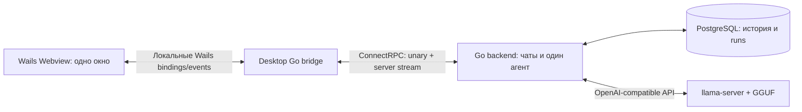

# n-projects — поэтапный план реализации

Дата обновления: 7 ноября 2026. Core реализован в коде; последующие этапы остаются планом. Подключение к готовому llama.cpp-сервису задаётся через env. Сквозная приёмка конкретного внешнего endpoint выполняется в пользовательском окружении.

## 1. Принцип реализации

**Первый результат — работающий Core: Go backend + Wails desktop + llama.cpp + сохраняемые чаты.** Пользователь может поднять проект, создать чат и общаться с одним диалоговым агентом. Следующие возможности добавляются отдельными завершёнными этапами.

[ARCHITECTURE.md](ARCHITECTURE.md) описывает целевую систему. Этот план определяет, **когда** появляется каждая её часть. При выборе объёма ближайшей реализации приоритет имеет этот план: полная архитектура не является чек-листом для Core.

Сохраняется выбранная топология: отдельный Go-сервер и подключающиеся к нему desktop-клиенты. В dev-профиле сервер, PostgreSQL и llama.cpp могут работать на одном компьютере. llama.cpp вызывается **бэкендом**; его endpoint не привязан к машине desktop-клиента.

**Desktop ↔ backend используют ConnectRPC с Protobuf с первого этапа.** Webview вызывает локальные Wails bindings; Go bridge обращается к backend через сгенерированный Go Connect-клиент. Команды — unary RPC, поток ответа — server-streaming RPC. У llama.cpp остаётся собственный OpenAI-compatible HTTP API; его протокол инкапсулирован в серверном model adapter.

Правила перехода между этапами:

1. Этап заканчивается демонстрацией работающего сценария и выполнением критериев приёмки.
2. Каждый этап сохраняет работоспособность сценария Core.
3. Пакеты, таблицы, зависимости и сервисы добавляются на этапе, где используются. Пустой каркас всей будущей платформы заранее не создаётся.
4. Технические проверки входят в соответствующий этап: для Core проверяются одно окно и streaming llama.cpp; checkpoint, OCR и multi-window проверяются перед реализацией этих возможностей.
5. Изменения оформляются небольшими самостоятельными задачами/PR. Один этап не должен превращаться в один большой PR.
6. Фиксированных сроков пока нет: они зависят от команды, целевых ОС, GPU и выбранной модели. Готовность определяется результатом, а не затраченным временем.

## 2. Карта этапов

| Этап | Пользовательский результат | Новая функциональность | Зависимость |
|---|---|---|---|
| **1. Core** | Можно запустить приложение и вести сохраняемые чаты с агентом через llama.cpp | Backend, один desktop Webview, ConnectRPC, PostgreSQL, streaming, Stop, история | — |
| **4. Долговечное выполнение** | Агент ждёт подтверждения, продолжает после рестарта и создаёт ответвления | Checkpoints, HITL, resume, durable events, fork, внутренний контракт исполнения и защита от повторов | 1 |
| **5. Субагенты и сценарии** | Агент делегирует задачи и выполняет составные workflows | Дерево runs, встроенный spawn, общие бюджеты, join, scenarios | 4 |
| **3. Инструменты и skills** | Агент использует общий каталог инструментов и внешние интеграции | Registry, schemas, tool loop, policy, skills, первый domain connector | 4 и 5 |
| **2. Командный доступ** | Несколько пользователей работают со своими и явно расшаренными чатами | OIDC, роли, владение, sharing и права на уже готовые runs/tools/approvals | 3 |
| **6. Документы** | Можно загрузить документ и дать агенту прочитать его | S3, ingestion worker, конвертация, preview, `read_document` | 3 и 2 |
| **7. RAG** | Агент находит информацию в коллекции документов и приводит источники | Embeddings, pgvector, retrieval, `rag_search`, цитаты | 6 |
| **8. Рабочая область desktop** | Чат, документы и задачи можно держать в отдельных окнах | Multi-Webview, синхронизация окон, канбан, уведомления, улучшение чатов | После 7; использует 5 и 6 |
| **9. Голос** | Можно надиктовать запрос и прослушать ответ | Push-to-talk, STT, TTS, локальная пауза по хоткею | После 8 |
| **10. Релиз для эксплуатации** | Команда устанавливает и обновляет проверенную сборку | Packaging, подпись, полная наблюдаемость, backup/restore, нагрузочные проверки | Все включённые в релиз этапы |

**Порядок реализации по решению пользователя: 1 → 4 → 5 → 3 → 2 → 6 → 7 → 8 → 9 → 10.** Номера исходных этапов сохранены как идентификаторы; строки таблицы и разделы ниже расположены в порядке работы.

Этапы 4–5 не зависят от полного registry или OIDC. Они используют dev identity из Core, узкий внутренний контракт исполнения и встроенные операции оркестрации. Общий каталог tools, skills и реальные domain connectors появляются на этапе 3; командные аккаунты и роли — на этапе 2.

## 3. Этап 1 — Core

### 3.1. Что именно считается Core

Core использует `adk.TurnLoop` и `adk.ChatModelAgent` (Eino v0.9.22). На каждый принятый Run создаётся ограниченный TurnLoop, получает сохранённую историю, выполняет один ход и завершает работу. Checkpoint/resume подключается на этапе 4.

Core — готовый минимальный продукт для текстового общения. «Агент» на этом этапе означает одного диалогового помощника: system prompt, контекст текущего чата, обращение к модели и потоковый ответ. Делегирование появляется на этапе 5, общий выбор доменных инструментов — на этапе 3.



**Входит в Core:**

| Область | Обязательный объём |
|---|---|
| Окружение | Закреплённые зависимости, mise-команды, конфигурация, инструкция запуска |
| Backend | ConnectRPC services, Protobuf-контракты, конфигурация, dev-аутентификация через interceptor, health checks, логи и корректное завершение |
| Хранение | PostgreSQL, миграции, Session, Message, Run; сохранение истории и результата выполнения |
| llama.cpp | Запуск `llama-server`, один совместимый GGUF, настраиваемые endpoint/model ID, streaming и отмена |
| Агент | Eino TurnLoop + ChatModelAgent: история → модель → streaming → сохранение ответа |
| Чаты | Создать, получить список, открыть историю, переименовать, удалить, отправить сообщение |
| Выполнение | Один активный run на чат, ограничение общей конкурентности, понятные ошибки, таймаут, Stop |
| Desktop | Одно окно: список чатов, сообщения, поле ввода, потоковый ответ, Stop, состояние подключения |
| Проверка | Сквозной сценарий с настоящим llama.cpp, сохранение после рестарта, отмена и переподключение |

**За границей Core:** инструменты и skill registry, субагенты, checkpoints/resume, HITL, fork, OIDC/RBAC и интерфейс администрирования, загрузка файлов, Pandoc/OCR, S3, embeddings/pgvector, RAG, голос, дополнительные Webview, канбан, коннекторы, полный OpenTelemetry-контур и HA.

### 3.2. Шаги внутри Core

| Шаг | Что реализовать | Проверяемый результат |
|---|---|---|
| **1.1. Запуск компонентов** | Go-модуль, `cmd/server`, `cmd/desktop`, frontend; mise и protoc; Protobuf/Connect codegen; PostgreSQL; llama-server; одно окно Wails; `.env.example` и README | Окно открывается; generated Go client вызывает backend; настоящий llama-server возвращает ответ на smoke-запрос |
| **1.2. Чаты и история** | Миграции Session/Message/Run, unary RPC для CRUD чатов, dev identity, проверки принадлежности, список и история в UI | Чат можно создать, переименовать, открыть и удалить; данные переживают перезапуск |
| **1.3. Диалоговый агент** | TurnLoop + ChatModelAgent, llama.cpp adapter, system prompt, контекст чата, создание run, сохранение assistant-message | Сообщение из desktop проходит через backend и llama.cpp; следующий ответ учитывает предыдущий ход |
| **1.4. Поток и Stop** | Server-streaming `WatchRun`, промежуточные snapshots, ограниченные буферы, unary `CancelRun`, таймауты и Connect errors | Текст появляется постепенно; Stop завершает локальное исполнение; закрытие stream отменяет только подписку |
| **1.5. Завершение пользовательского сценария** | Состояния loading/empty/error, переключение чатов, reconnect, поведение при рестарте, защита от двойной отправки | Открытие другого чата не обрывает run; reconnect показывает актуальный ответ; повтор unary RPC не создаёт второй run |
| **1.6. Приёмка Core** | Интеграционные проверки, сборка, запуск по README на чистом окружении, фиксация рабочей конфигурации модели | Выполнен сценарий из раздела 3.7; готова первая используемая сборка |

UI подключается по мере готовности API, а не откладывается до завершения всего backend. Первый настоящий ответ модели должен быть получен уже на шаге 1.3.

### 3.3. Минимальная структура проекта

```text
cmd/server/
cmd/desktop/
internal/app/
internal/chat/             # Session, Message, SQL и операции чатов
internal/agent/            # Run, ограниченный executor, контекст и отмена
internal/agent/engine/     # Eino TurnLoop + ChatModelAgent и llama.cpp adapter
internal/rpc/              # Connect handlers/interceptors, перевод Protobuf ↔ application types
internal/apiclient/        # обёртка generated Go Connect-клиента для desktop
internal/desktop/          # Wails bindings и одно окно
internal/platform/config/
internal/platform/postgres/
frontend/src/features/chat/
proto/nprojects/v1/        # SessionService, RunService и сообщения
gen/go/nprojects/v1/       # generated Protobuf и Connect-код
migrations/
deploy/compose.yaml        # только инфраструктура текущего этапа
.mise.toml
.env.example
README.md
```

Registry, documents, speech и ingestion worker появляются на своих этапах. Направление импортов сохраняется из архитектуры: `agent` объявляет небольшой интерфейс engine, реализация подключается в `app`.

### 3.4. Решения, которые удерживают Core небольшим

- **Один backend-процесс.** Ограниченный executor работает в нём; начальная конкурентность генерации — 1, настраиваемая. При заполнении слотов API возвращает понятное «агент занят». Долговечная очередь и несколько исполнителей появляются на этапе 4.
- **PostgreSQL сразу.** База нужна для реального использования чатов и соответствует целевой серверной топологии. pgvector и object storage пока не устанавливаются.
- **Dev identity вместо готовой системы пользователей.** Один тестовый workspace/пользователь создаётся bootstrap-конфигурацией, Connect interceptor проверяет dev bearer token. В Session/Run сохраняются `workspace_id/owner_id`; проверки доступа выполняются для unary и streaming RPC. Этот режим сохраняется на этапах 4, 5 и 3; независимые аккаунты команды появляются на этапе 2. Передача токена удалённому серверу выполняется по TLS, локальный профиль слушает loopback.
- **Минимальное состояние Run.** `running`, `cancelling`, `succeeded`, `failed`, `cancelled`, `interrupted`. Единственный процесс при запуске закрывает оставшиеся активные runs как прерванные, сохраняя частичный ответ. Для Core `interrupted` — завершённый исход, освобождающий чат. Повтор пользователя создаёт новый Run; автоматического resume нет. На этапе 4 восстановление расширяется отдельной миграцией и новым протоколом.
- **Жизненный цикл run независим от соединения.** Обрыв `WatchRun`, переключение чата и закрытие desktop не отменяют серверную генерацию. Stop вызывает отдельный unary RPC `CancelRun`; завершённый ответ доступен при следующем подключении.
- **Connect server stream без долговечного event log.** Backend сохраняет промежуточный текст, статус и монотонную revision согласованно в одной транзакции. `WatchRun` отправляет типизированный snapshot сообщения/статуса: сервер сначала регистрирует listener, затем получает snapshot и отправляет только более новые revisions. Клиент заменяет текст, а не повторно добавляет его. Reconnect заново вызывает RPC и получает свежий snapshot. Медленный клиент переподключается; полный `RunEvent` и replay по `after_seq` появляются на этапе 4. Автоматическое восстановление подписки реализуется Go-клиентом приложения, не предполагается свойством ConnectRPC.
- **Простой контекст.** System prompt и последние завершённые ходы текущего чата в пределах лимита модели; незавершённые ответы не выдаются за полные. При отсечении старой истории UI сообщает об ограничении; слишком большое одиночное сообщение возвращает понятную ошибку. Автоматическое summary добавляется на этапе 8.
- **Простая защита повторов.** Создание пользовательского сообщения и Run выполняется одной транзакцией; `request_id` в изменяющем Protobuf-запросе служит ключом идемпотентности и не допускает дубля при сетевом повторе. Удаление чата с активным run возвращает Connect `FailedPrecondition` до его остановки.

Контракт Core: `SessionService.CreateSession/ListSessions/GetSession/UpdateSession/DeleteSession/ListMessages` и `RunService.StartRun/GetRun/CancelRun/WatchRun`. Все методы unary, кроме `WatchRun` с server streaming. Источник контракта — `.proto`; protoc выполняет codegen; проверка proto:check обнаруживает расхождения generated-кода с коммитом. Go-клиент desktop и Go handlers генерируются вместе. Отдельный TypeScript Connect-клиент не нужен: Webview использует локальные bindings.

Доменный `Run.status=failed` приходит в типизированном snapshot; transport/RPC error приходит как Connect error. `Unavailable` допускает reconnect подписки, `Unauthenticated/PermissionDenied` требует обновления доступа, `ResourceExhausted` отображает занятость, `InvalidArgument` — ошибку ввода. Повтор изменяющего RPC использует тот же `request_id`; слепой автоматический retry всех команд не включается.

### 3.5. Контракт подключения llama.cpp

Используется `llama-server` и его OpenAI-compatible chat API. Инференс — отдельный процесс; Go backend не встраивает C/C++ runtime через cgo и не запускает модель заново для каждого сообщения.

Нужно реализовать:

1. Основной сценарий — подключение к готовому llama.cpp-сервису через env, по уточнению пользователя. Версия сервиса, модель и веса управляются его владельцем; проект не требует их установки. Локальный launcher остаётся опциональным.
2. Настройки backend: `LLAMA_BASE_URL` (например, `http://127.0.0.1:8081/v1`), `LLAMA_MODEL`, timeout. Настройки launcher: путь к GGUF, context size, CPU/GPU-параметры.
3. Проверку доступности endpoint и совпадения model ID; запрос к `/v1/chat/completions` с `stream=true` через совместимый Eino-компонент или небольшой adapter.
4. Обработку конца потока, некорректного ответа, недоступности модели, превышения context window и отмены HTTP-запроса.
5. Один рабочий профиль модели на выбранной машине. Совместимость GGUF с закреплённым llama.cpp подтверждается реальным запуском. Конкретная Gemma из исходного черновика не считается автоматически совместимой; выбор модели фиксируется на шаге 1.1.

Stop гарантирует прекращение локального чтения и дальнейшего формирования ответа; фактическое освобождение inference slot проверяется на выбранной версии llama-server. Успешная отмена в UI не должна скрывать продолжающуюся занятость сервера модели.

### 3.6. Команды, которые должны появиться в Core

Это проект команд будущего репозитория, а не уже существующие исполняемые скрипты.

| Команда | Обязанность |
|---|---|
| `mise install` | Установить закреплённые доступные инструменты |
| `docker build -t n-projects:local .` | Собрать минимальный multi-stage образ backend |
| `mise run compose:up` | Запустить backend и PostgreSQL без сборки |
| `mise run migrate` / `migrate:status` / `migrate:down` | Операторские задачи Goose; URL должен быть доступен с хоста |
| `mise run generate` | Сгенерировать Protobuf и Go Connect-код через protoc |
| `mise run test` / `fmt` | Проверки и форматирование |

README описывает первый запуск, получение выбранной модели, конфигурацию и подключение desktop к удалённому backend. При внешнем llama-server launcher пропускается; backend использует заданный URL. Компиляция llama.cpp и нативные SDK выполняются соответствующими средствами сборки, вызванными из mise-задач.

### 3.7. Критерии приёмки Core

Core готов только после следующей демонстрации с **настоящим llama.cpp**:

1. На чистом поддерживаемом окружении по README установлены инструменты и настроен готовый llama.cpp endpoint; образ собирается через Dockerfile, `mise run compose:up` поднимает backend и PostgreSQL, отдельный Wails-клиент подключается к серверу.
2. Пользователь создаёт чат, отправляет сообщение и видит ответ по частям.
3. Второе сообщение опирается на контекст первого в пределах известного context limit.
4. Создан второй чат; истории и контекст чатов не смешиваются. Переименование и удаление работают.
5. Stop прекращает вывод, run переходит в завершённое состояние; следующий запрос получает настоящий ответ llama.cpp, подтверждая освобождение inference slot, а не только принятие запроса backend.
6. Перезапуск desktop и backend сохраняет чаты и завершённые сообщения. Падение backend во время генерации оставляет видимый неполный ответ и прерванный run; чат остаётся пригодным для нового запроса.
7. После разрыва и восстановления соединения UI получает актуальный snapshot без дублирования текста, включая уже завершившийся run.
8. Недоступный llama-server, таймаут и слишком большой запрос показываются как понятные ошибки; UI выходит из состояния загрузки.
9. Повтор unary RPC с тем же `request_id` не создаёт второе сообщение/run. Второй активный run того же чата отклоняется явно.
10. Desktop подключается к отдельно запущенному backend по настройке URL; токен не попадает в frontend storage и журналы. Базовые integration-тесты API/БД и сборка проходят.

Минимальные автоматические проверки покрывают сохранение данных, принадлежность ресурсов, идемпотентность, snapshot-reconnect и отмену через управляемый test provider. Они дополняются smoke-проверкой настоящего llama-server: mock не подтверждает совместимость модели.

Приёмка транспорта проходит через generated Go Connect-клиент: unary-команды, streaming, Connect error codes, отмена подписки отдельно от `CancelRun`, reconnect и повтор с `request_id`. Удалённый профиль проверяется через используемый TLS/reverse proxy: streaming не буферизуется целиком, таймауты допускают длительную генерацию. `mise run generate` воспроизводит committed generated-код.

## 4. Этап 4 — Долговечное выполнение, HITL и fork

**Зависит только от Core.** На этом этапе создаётся узкий внутренний контракт исполняемого шага: стабильный invocation ID, тип/версия шага, сериализуемые аргументы и результат, политика повтора, callback исполнения. Он используется встроенным Eino-сценарием и контролируемым адаптером внешнего действия. Это основание для будущих tools; общий registry, skill manifests и выбор произвольных инструментов моделью сюда не входят.

Разбить этап на три последовательные поставки:

| Шаг | Реализовать | Приёмка |
|---|---|---|
| **4.1. Сохранение и восстановление** | PostgreSQL queue/lease, versioned checkpoints, правила safe retry, durable events и `WatchRun(after_seq)` | Рестарт на безопасном шаге продолжает run; старый исполнитель не перезаписывает результат; Connect-подписка дочитывает события после cursor |
| **4.2. Подтверждения и внешние эффекты** | Approval, `waiting_input`, атомарная публикация checkpoint + ожидания, unary `RespondToApproval`, ledger исполнения, idempotency/unknown outcome | Approval переживает restart; повтор RPC не вызывает действие дважды; timeout внешнего изменения не трактуется как доказанный отказ |
| **4.3. Ответвления** | Unary `ForkSession`: диалог по сохранённой границе; исполнение по совместимому checkpoint | Новая ветка независима; завершённые внешние действия не повторяются; старое подтверждение не действует в новой ветке |

Рабочий сценарий: модель готовит результат → встроенный шаг запрашивает ввод/подтверждение → граф сохраняется и освобождает слот → пользователь отвечает через desktop → граф продолжает работу. Для проверки side effects используется контролируемый тестовый сервис со счётчиком/operation ID; реальный CRM/tracker connector появится на этапе 3.

Подтверждение даёт bootstrap-пользователь из Core. На каждом переходе проверяются actor/ownership и актуальная policy; её реализация пока использует dev identity. Отказ, истечение срока, отмена и недействительная dev-авторизация во время паузы имеют явные переходы. OIDC/membership добавляются на этапе 2 без изменения протокола checkpoint/approval.

**Не входит:** общий tool registry, skills, командные роли, дерево субагентов, fork внутри работающего внешнего вызова и обещание exactly-once для любого стороннего API.

**Приёмка этапа:** desktop демонстрирует «подготовить результат → запросить разрешение → перезапустить backend → подтвердить → продолжить». Тестовый внешний эффект выполняется по его контракту идемпотентности; проверяются cancel/resume race, повтор RPC и сбой между эффектом и записью результата. Replay `WatchRun` после рестарта не теряет и не дублирует события. При устаревшем cursor клиент получает новый согласованный snapshot. Изменение трактовки `interrupted` относительно Core сопровождается миграцией; старые прерванные runs не запускаются сами.

## 5. Этап 5 — Субагенты и сценарии

**Реализовать:** дочерние runs, встроенную операцию `spawn_subagent`, ограниченную параллельность/глубину, общий бюджет дерева, устойчивый join, передачу разрешённого контекста, сбор результатов и отмену поддерева. Использовать checkpoint/ledger этапа 4. Внутренние transcripts детей изолированы от истории родителя. Добавить простой экран дерева выполнения в существующем окне.

`spawn_subagent` подключается непосредственно к Eino как одна фиксированная операция оркестрации с типизированной схемой. Это позволяет модели выбирать делегирование до появления общего registry. Поддержку такого вызова в llama.cpp/chat template проверить на этом этапе. На этапе 3 та же реализация регистрируется в общем каталоге; второй исполнитель или отдельный механизм восстановления не создаётся.

Добавить версионированные сценарии из встроенных graph steps. Первый законченный сценарий — два субагента независимо анализируют переданный пользователем текст, родитель объединяет их выводы. При необходимости родитель запрашивает уточнение через уже готовый HITL. Документы, внешние коннекторы и общий набор tools для этого не требуются.

**Не входит:** общий tool/skill registry, CRM/tracker connectors, OIDC/RBAC, неограниченное порождение агентов, произвольный shell, редактирование локального репозитория пользователя и дополнительные окна.

**Приёмка:** настоящий агент через llama.cpp делегирует две задачи, UI показывает дерево, родитель объединяет результаты в пределах бюджета. Проверяются restart с детьми, пауза ребёнка на HITL, раннее завершение до join и cancel одновременно со spawn. Существующие навыки Core и этапа 4 продолжают работать с dev identity.

## 6. Этап 3 — Инструменты, skills и первый domain connector

**Реализовать:** общий model → tool → model loop в Eino, статический tool registry, JSON schemas, валидацию аргументов, per-call policy, timeout и лимит шагов. Использовать отдельный набор tools на run. Добавить версионированные skill manifests и выбор skill для чата/run; skill не расширяет права.

Registry использует внутренний контракт, ledger, approvals и checkpoints этапа 4; `spawn_subagent` из этапа 5 подключается к нему без переписывания. Первые read-only tools: `search_chats` и `read_chat_messages` в области dev-пользователя. UI показывает имя операции, безопасные аргументы, статус и результат.

Следом добавить один реальный CRM/tracker connector: выбранный API, credentials, permissions и read/write tools. Чтение проверяется первым; изменяющие вызовы используют уже готовые подтверждения и обработку неизвестного исхода. Конкретная система выбирается перед задачей интеграции. Простой прикладной сценарий использует этот connector и, при необходимости, делегирование.

Этап ещё работает в dev-режиме. Политики проверяются на тестовых субъектах/ресурсах, в данных сохраняются owner/workspace и ссылки на источники. Реальные командные аккаунты, общий чат и sharing появляются следующим этапом. Доступ к источнику не считается автоматическим разрешением публиковать его содержимое другой аудитории.

**Не входит:** OIDC/RBAC и UI управления пользователями, динамическая загрузка кода plugins, RAG и произвольный доступ к локальным путям.

**Приёмка:** агент выбирает tool из каталога, получает результат и отвечает; неверные аргументы, недоступный ресурс, цикл tools и отмена обрабатываются предсказуемо. Реальный connector выполняет чтение и предусмотренное подтверждённое изменение по контракту провайдера. Resume/fork/subagents сохраняют гарантии этапов 4–5. Тесты доказывают повторную policy-проверку перед фактическим вызовом.

## 7. Этап 2 — Командный доступ

**Реализовать:** OIDC login через системный браузер и PKCE, хранение токенов в Go/OS keychain, пользователей и membership, роли Admin/Member/Read-only, владение чатами и sharing, минимальное управление доступом. Заменить dev identity в Connect interceptors и application policy; определить миграцию тестовых данных и ожидающих approvals. Добавить аудит входов и изменений прав.

Права охватывают все уже реализованные функции: списки и историю, `StartRun/CancelRun`, `WatchRun`, tools/connectors, children, checkpoint/fork и approvals. Read-only читает разрешённое, но не запускает, не подтверждает и не изменяет. После паузы права проверяются заново; дети наследуют пределы доступа, а не получают собственные расширенные полномочия.

Для общего чата tools читают только источники, доступные всей аудитории; sharing существующего чата проверяет сохранённые ссылки на приватные источники. При отсутствии такой гарантии cross-chat tools ограничиваются личными чатами. Это предотвращает перенос личных данных в общий чат через агентный ответ.

**Не входит:** новые tools/scenarios, документы, собственная система хранения паролей и изменение механизма исполнения уже готовых runs.

**Приёмка:** два реальных пользователя видят только разрешённые чаты, runs и артефакты; sharing предоставляет доступ без раскрытия приватных источников. Отзыв membership прекращает дальнейшую доставку Connect stream и запрещает следующий tool/approval; Read-only не обходит ограничения прямым RPC. Проверяются отзыв прав во время HITL, fork и наследование прав субагентом. Первый тестовый командный запуск возможен после этого этапа.

## 8. Этап 6 — Документы и обработка файлов

**Реализовать:** file picker и явную загрузку, S3-совместимое хранилище, Document/Version/IngestionJob, отдельный worker, статус обработки, просмотр извлечённого текста, `read_document` с проверкой доступа. Документ связывается с чатом, агент читает разрешённый диапазон текста напрямую.

Для общего чата документ и публикуемые выдержки должны быть доступны всей аудитории чата. Проверка прав одного инициатора недостаточна; добавление участников и sharing проверяют права на связанные источники.

Поставки внутри этапа:

1. TXT/Markdown, DOCX и HTML: полный путь upload → extract → ready → чтение агентом.
2. PDF с текстом, XLSX, RTF и EPUB: матрица форматов, Pandoc/специализированные extractors, координаты источника.
3. Сканированные PDF: OCR, язык, лимиты и видимое качество извлечения.

Изоляция парсеров, ограничения размеров/распаковки/времени, идемпотентность обработки, удаление объектов и ACL входят вместе с соответствующим форматом. Оригиналы и производные данные резервируются с момента появления хранилища.

**Не входит:** векторный поиск, embeddings, автоматический подбор фрагментов из всей базы знаний.

**Приёмка:** поддерживаемые fixtures проходят путь до чтения агентом; повреждённый файл даёт понятную ошибку; чужой документ недоступен; restart worker не создаёт конфликтующие версии; удалённый документ перестаёт читаться. На этом этапе уже можно обсуждать конкретный загруженный файл.

## 9. Этап 7 — RAG и база знаний

**Реализовать:** структурное chunking, отдельный embedding profile, pgvector, версионирование индексов, коллекции документов, retrieval и `rag_search`, ответ с цитатами и переходом к источнику. Частичный индекс не публикуется; смена embedding-модели запускает reindex.

Проверки доступа включаются непосредственно в поиск до передачи текста модели и учитывают аудиторию чата по правилам этапа 6. Добавить небольшой набор вопросов по документам для оценки качества и ситуаций «ответа в источниках нет».

**Не входит:** отдельный Qdrant-кластер, автоматический доступ к любым корпоративным источникам, сложный reranker без подтверждённой необходимости.

**Приёмка:** агент находит релевантные фрагменты по нескольким документам и даёт проверяемые цитаты; не выдаёт чужие chunks; обновление/удаление документа отражается в поиске; reindex не смешивает несовместимые embeddings. Качество сравнивается с заранее подготовленными ожидаемыми источниками.

## 10. Этап 8 — Рабочая область desktop

**Реализовать:** второе и последующие Webview, маршрутизацию событий через Go bridge, синхронизацию состояния, отдельные окна документов и дерева агентов, канбан активных сессий, OS notifications при работе приложения в фоне. Доставка событий ограничивает буферы и объединяет обновления перед render.

Здесь же добавить удобства чатов: асинхронное название после первого сообщения с защитой ручного переименования, поиск чатов в UI поверх backend-поиска этапа 3, архив чатов, управляемое summary длинной истории. Проверить, требуется ли изоляция browser storage между окнами, и реализовать ровно согласованную гарантию.

**Не входит:** уведомления при полностью завершённом desktop без фонового процесса, offline execution и показ скрытых внутренних рассуждений модели. Панель показывает этапы, tools, результаты и краткие объяснения.

**Приёмка:** два окна одновременно показывают один run без дубликатов и расхождения текста; закрытие вспомогательного окна не отменяет задачу; фоновое завершение даёт одно уведомление; summary не уничтожает исходную историю. Поведение проверяется на заявленных ОС.

## 11. Этап 9 — Голос

**Реализовать:** push-to-talk, запись через MediaRecorder, согласование кодеков, ограниченную передачу аудиочанков, STT adapter, редактирование распознанного текста перед отправкой. Затем TTS сегментами, воспроизведение в клиенте, немедленную локальную паузу через кнопку/хоткей и отмену ненужного синтеза.

Выбрать конкретные STT/TTS providers и профиль хранения аудио. Speech остаётся модулем backend с адаптерами, пока отдельный процесс не требуется для inference или нагрузки.

**Не входит:** постоянное прослушивание микрофона, полноценный realtime duplex, автоматический barge-in и отдельный speech-кластер.

**Приёмка:** пользователь надиктовывает запрос, проверяет текст, отправляет его в обычный чат и слышит ответ. Пауза не ждёт сетевого round trip; ошибки записи/STT/TTS не нарушают текстовый сценарий. Кодеки и хоткей проверены на поддерживаемых ОС.

## 12. Этап 10 — Релиз для эксплуатации

**Реализовать:** CI-сборки и пакеты для выбранных ОС, подпись и понятный процесс обновления, версионирование API, deployment/runbooks, резервное копирование и проверку восстановления, retention, full OpenTelemetry traces/metrics, нагрузочный профиль и наблюдаемые SLO.

Базовые логи, проверки доступа, нужные тесты и лимиты реализуются вместе с каждой функцией. Этот этап объединяет и проверяет эксплуатационный контур; он не откладывает корректность работы до конца проекта.

**Не входит по умолчанию:** Kubernetes, Kafka, переход на микросервисы, автоматическое масштабирование и высокая доступность. Эти изменения требуют измеренной причины.

**Приёмка:** сборка устанавливается на чистую систему; обновление сохраняет данные и корректно обрабатывает pending runs; backup восстанавливает БД и связанные файлы; нагрузочная проверка определяет поддерживаемую конкурентность и обнаружение отказов. Релиз имеет перечень поддержанных ОС, моделей, форматов и известных ограничений.

## 13. Последующие расширения с отдельным scope

Эти направления не блокируют Core и не считаются автоматически включёнными в первый полный релиз:

| Направление | Когда добавлять и что требуется |
|---|---|
| Рефакторинг кода и локальные каталоги | После этапов 4–5: отдельный workspace runner, разрешённые корни, checkout, diff, политика записи, изоляция команд и отмена процессов. Приёмка — изменение тестового проекта только в разрешённой области с просмотром diff |
| Новые CRM/tracker-интеграции | После первого рабочего connector: каждая как отдельная задача со своими правами, rate limits, credentials и retry-контрактом |
| Другие chat providers, vLLM/Ollama | После стабильного llama.cpp-пути: отдельный adapter/profile и проверка streaming/tool calling/cancel; доменная модель не меняется |
| Realtime voice, закрытое приложение, offline | Отдельные продуктовые решения и протоколы, после проверки востребованности базовых сценариев |
| Отдельные agent workers, Qdrant, broker, HA | После нагрузочных измерений и появления конкретного ограничения текущей архитектуры |

## 14. Ближайший объём работ

Следующая задача на реализацию — **только этап 1, шаги 1.1–1.6**. Его завершение означает работающий диалоговый продукт с llama.cpp и сохраняемыми чатами. До приёмки Core подключение функций последующих этапов не входит в объём этой задачи.

Миграции БД выполняются Goose из `migrations/` отдельной mise-задачей. Генерация ConnectRPC выполняется `protoc`, установленным через mise; Buf не используется.

Backend в разработке и production запускается через Compose из предварительно собранного образа. Wails — отдельный клиент. Локальные dev/build-задачи и scripts удалены; сборка Dockerfile и compose up выполняются разными командами.

Runtime backend — distroless static-debian12:nonroot; образ содержит только серверный бинарник поверх runtime. Миграции остаются в migrations/ и применяются с хоста отдельной mise-задачей.
