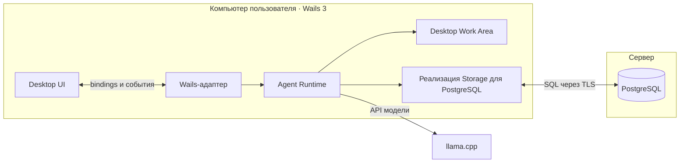
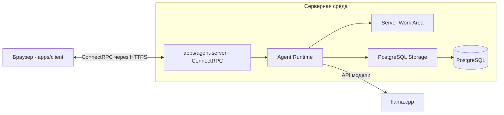

# n-projects

Монорепозиторий AI-платформы с общим агентом на Go. Первый целевой вариант — Wails 3 на компьютере пользователя. Агент выполняет задачи в локальной рабочей области и сохраняет переписку в PostgreSQL на сервере. Для браузера запланирован серверный агент с тем же ядром и API на ConnectRPC.

Целевые сценарии — поиск по корпоративным документам с указанием источников, подготовка сравнительных отчётов и работа с кодом в выбранной рабочей области.

| Состояние | Что входит |
|---|---|
| Реализовано | Библиотека `agentcore` на CloudWeGo Eino, адаптеры Wails и ConnectRPC, хранилище PostgreSQL, миграции Goose и Compose для БД |
| Ближайшая интеграция | Приложение `apps/desktop` с UI, локальным Agent Runtime, desktop Work Area и подключением к удалённой БД |
| Запланировано | `apps/agent-server` и `apps/client`, серверная Work Area, управление доступом, реестр инструментов и MCP, многошаговые сценарии, обработка документов и голос |
| Отложено | SQLite, постоянный локальный кэш истории и синхронизация после работы офлайн |

## Границы компонентов

| Компонент | Ответственность |
|---|---|
| **Agent Runtime** | Принимает команды, ведёт ход диалога и публикует события. Работает с моделью через Eino, читает и записывает сообщения через порт `Storage`. Общие правила выбора skills, вызова MCP-инструментов и ожидания ответа пользователя относятся сюда. |
| **Work Area** (план) | Предоставляет среду для выполнения действий агента. На desktop это выбранные файлы, процессы и подключения на компьютере пользователя. На сервере — файлы и процессы серверного рабочего пространства. Каждая среда сможет подключать собственный MCP-сервер. |
| **UI и входные адаптеры** | Desktop вызывает Go-сервис через Wails bindings и получает события окна. Браузер будет вызывать ConnectRPC-сервис по сети. Оба адаптера передают команды одному и тому же типу `Engine`. |
| **Хранилище** | Приложение передаёт реализацию порта в `NewEngine`. Адаптер PostgreSQL общий для desktop и сервера. Реализация `MemoryStorage` помечена как deprecated и временно закомментирована. |

### Как проходит ход диалога

1. Приложение создаёт сессию, подписывается на её события и отправляет сообщение через `Send`. Успешный вызов означает, что движок принял команду. Флаг `preempt` позволяет новому сообщению прервать активный ход в безопасной точке Eino.
2. Цикл Eino `TurnLoop` готовит вход модели из сохранённой переписки и новых сообщений. Инструменты передаются агенту в `LLMConfig.Tools`. Подписка передаёт границы хода, фрагменты ответа, вызовы инструментов, их результаты и ошибки.
3. При повторном открытии чата UI запрашивает `History` в Wails или `GetHistory` в ConnectRPC. Ответ содержит сообщения в порядке записи. Внутри сообщения сохраняется порядок блоков `text`, `tool_call`, `tool_result`. Поле `text` сообщения объединяет видимые текстовые блоки. По `call_id` можно сопоставить вызов и результат, когда этот идентификатор есть в данных инструмента.

## Структура проекта

[Макет desktop-чата и описание сценариев](docs/desktop-chat/README.md)

```text
.
├── agentcore/
│   ├── agent.go                        # Конфигурация модели и создание агента
│   ├── engine.go                       # API движка и представление истории
│   ├── session.go                      # Жизненный цикл и прерывание сессии
│   ├── session_turn.go                 # Выполнение хода и сохранение сообщений
│   ├── session_events.go               # Поток событий и подписчики
│   ├── types.go                        # Типы событий и пользовательских команд
│   ├── storage.go                      # Контракт хранилища
│   └── memory_store.go                 # MemoryStorage (deprecated, отключён)
├── adapters/
│   ├── postgres/storage.go         # PostgreSQL для desktop и сервера
│   ├── wailsagent/service.go       # Вызовы из desktop UI
│   └── connectagent/handler.go     # Реализация RPC-обработчиков
├── docs/desktop-chat/              # HTML-макет и правила взаимодействия
├── migrations/
│   └── 00001_agent_sessions.sql    # Сессии и упорядоченная история
├── proto/agent/v1/
│   ├── agent.proto                 # Контракт RPC
│   ├── agent.pb.go                 # Сгенерированные типы сообщений
│   └── agentv1connect/agent.connect.go  # Сгенерированные клиент и обработчик
├── go.mod
├── go.sum
├── compose.yaml                    # PostgreSQL и постоянный том
├── .env.example                    # Шаблон настроек подключения
├── .gitignore                      # Исключает локальный .env
├── mise.toml
└── README.md
```

Каталоги приложений появятся по мере реализации.

```text
apps/
├── desktop/          # План — desktop-приложение Wails 3
├── agent-server/     # План — серверное приложение с Agent Runtime
└── client/           # План — браузерный UI для agent-server
```

## Окружение и запуск PostgreSQL

Для локальной разработки нужны mise и Docker с Compose v2. Корневой `mise.toml` устанавливает Go (`latest`) и Goose 3.30.1. В `go.mod` указана минимальная версия Go 1.27.4. Команды ниже поднимают базу и готовят схему. Исполняемые приложения появятся на этапе интеграции.

Compose запускает PostgreSQL 18 из образа `postgres:18-bookworm`. Данные хранятся в томе `postgres18_data`, подключённом к `/var/lib/postgresql`.

Адрес публикации задаётся в `.env` **на сервере с Docker**. Выберите его по способу подключения.

| Подключение | Настройки сервера | Адрес для клиента |
|---|---|---|
| С самого сервера или через SSH-туннель | По умолчанию `PG_BIND_ADDRESS=127.0.0.1`, `PGPORT=5432` | На сервере — `127.0.0.1:5432`. На desktop с туннелем — локальный адрес и порт туннеля |
| Напрямую по LAN или VPN | Например, `PG_BIND_ADDRESS=10.20.0.5`, если этот адрес принадлежит серверу, и `PGPORT=55432` | Desktop подключается к `10.20.0.5:55432` или к DNS-имени сервера с тем же портом |

После изменения этих значений выполните `mise run compose:up`. Для миграций Goose по умолчанию подключается к `127.0.0.1` через `PGPORT`. При публикации на конкретном LAN/VPN-интерфейсе задайте `GOOSE_DBSTRING` с доступным адресом этого интерфейса. Явный порт в строке подключения имеет приоритет над `PGPORT`. Для прямого подключения с проверкой сертификата настройте TLS на PostgreSQL и используйте на клиенте имя сервера, указанное в сертификате.

Если у вас уже есть данные в PostgreSQL 17, начните с раздела о переносе ниже. Для новой базы скопируйте шаблон в корне проекта.

```sh
cp -n .env.example .env
```

Задайте в `.env` непустой `PGPASSWORD` для роли `agentcore`. Docker Compose читает файл при подстановке переменных, mise загружает его для задач Goose. Локальный файл исключён из Git. При запуске в CI параметры можно передать через окружение без создания файла.

```sh
mise install
mise run compose:up
mise run migrate:up
mise run migrate:status
```

При запуске `compose:up` ждёт готовности PostgreSQL. Docker выполняет `pg_isready` через `CMD-SHELL` внутри контейнера. Параметр `-U` задаёт роль из `POSTGRES_USER`, а `-d` — базу из `POSTGRES_DB`. В этом проекте оба значения равны `agentcore`. Двойной знак доллара (`$$`) передаёт в контейнер один буквальный `$`, чтобы переменные раскрыла оболочка контейнера. Проверка обращается к PostgreSQL через локальный Unix-сокет и работает при любом опубликованном порте.

Docker запускает проверку с интервалом 5 секунд (`interval`), отводит до 3 секунд на попытку (`timeout`) и присваивает контейнеру статус `unhealthy` после 12 последовательных неудач (`retries`).

На пустом томе образ PostgreSQL создаёт базу и роль `agentcore` с указанным паролем. При повторном запуске используйте пароль существующей роли. Goose запускается на хосте, использует этот же `PGPASSWORD` и читает SQL из корневой папки `migrations/`. Для другого сервера или отдельной миграционной роли задайте `GOOSE_DBSTRING` в `.env` или в окружении CI и укажите пароль миграционной роли в `PGPASSWORD`. При выпуске применяйте миграции один раз на сервере.

| Команда | Действие |
|---|---|
| `mise run compose:up` | Запустить PostgreSQL в фоне и дождаться готовности |
| `mise run compose:down` | Остановить Compose с сохранением тома |
| `mise run compose:ps` | Показать состояние контейнера |
| `mise run compose:logs` | Показать последние 100 строк и следить за новыми |
| `mise run migrate:status` | Показать состояние миграций |
| `mise run migrate:up` | Применить ожидающие миграции |
| `mise run migrate:down` | Откатить последнюю миграцию. Откат первой удаляет таблицы сессий и сообщений |
| `mise run migrate:create add_chat_title` | Создать очередной пронумерованный SQL-файл |

### Перенос существующей базы с PostgreSQL 17

Порядок ниже рассчитан на базу и роль `agentcore` из прежнего Compose. Остановите запись из приложений и оставьте PostgreSQL 17 работающим. Перед заменой Compose сохраните дамп за пределами тома. Перейдите к остановке базы только после успешного завершения `pg_dump`.

```bash
docker compose exec -T postgres pg_dump -U agentcore -d agentcore -Fc > agentcore-pg17.dump
```

Остановите старый контейнер командой `mise run compose:down`, установите обновлённый Compose и задайте `PGPASSWORD` для новой роли в `.env` или в окружении. Старый том `postgres_data` сохраняется. Запустите PostgreSQL 18 с новым пустым томом и восстановите дамп до запуска миграций.

```bash
mise run compose:up
docker compose exec -T postgres pg_restore -U agentcore -d agentcore --single-transaction < agentcore-pg17.dump
```

После успешного восстановления выполните `mise run migrate:status` и `mise run migrate:up`. Перед возобновлением записи проверьте историю существующего чата. Если в старом кластере были дополнительные роли, подготовьте их до восстановления. [Формат каталогов официального образа PostgreSQL](https://github.com/docker-library/docs/blob/master/postgres/README.md#pgdata)

### Подключение хранилища к движку

Приложение открывает пул с параметрами своей роли и передаёт его в один и тот же адаптер на обеих платформах. В примере ниже `databaseURL` приходит из конфигурации, `ctx` живёт до завершения приложения, `agent` создан через `agentcore.NewLlamaCppAgent`.

```go
pool, err := pgxpool.New(ctx, databaseURL)
if err != nil {
    return err
}
defer pool.Close()
if err := pool.Ping(ctx); err != nil {
    return err
}
engine := agentcore.NewEngine(ctx, postgres.New(pool), agent)
defer engine.Shutdown()
// Здесь приложение регистрирует Wails- или ConnectRPC-адаптер и обслуживает вызовы.
```

Пакеты примера — `github.com/jackc/pgx/v5/pgxpool`, `my-gitlab/ai-support/n-projects/adapters/postgres` и `my-gitlab/ai-support/n-projects/agentcore`. Пул закрывает создавшее его приложение при завершении работы.

Wails и ConnectRPC предоставляют метод `ListSessions`. В основе обоих адаптеров — `Engine.ListSessions(ctx, page, pageSize)`, который возвращает `SessionPage` с массивом `sessions`. Подгрузка при прокрутке заканчивается после первой успешно полученной пустой страницы (`{"sessions":[]}`). После короткой непустой страницы можно запросить следующую. Страницы начинаются с 1. При `pageSize = 0` выдаются до 50 сессий, максимум — 100. Список включает сессии с сохранёнными сообщениями, отсортированные по `last_activity_at DESC, id DESC`. Заголовок берётся из первой непустой строки первого пользовательского сообщения и ограничен 60 символами с учётом многоточия. Для чата без текстового названия используется «Новый чат».

Таблица `agent_messages` хранит общий для всех чатов `id bigint GENERATED ALWAYS AS IDENTITY`, время записи `created_at timestamptz` и полное сообщение Eino в `payload`. История читается по индексу `(session_id, id)` в порядке возрастания ID внутри выбранного чата. В ответе `History` доступны ID и время каждого сообщения. В JSON идентификатор передаётся десятичной строкой для точной обработки в JavaScript, поле `createdAt` содержит время в формате RFC 3339.

У новой сессии `last_activity_at` равен `NULL`. При записи сообщения адаптер сначала обновляет строку сессии, затем вставляет сообщение с тем же временем. Обе записи выполняются одним SQL-оператором. Блокировка строки сессии упорядочивает выдачу ID при одновременной записи в один чат. Схема включена в начальную миграцию `00001`. Для баз, где Goose уже отметил прежнюю версию `00001` как применённую, потребуется отдельное обновление схемы.

## Предполагаемые схемы деплоя

### 1. Первый этап — Wails на компьютере, PostgreSQL на сервере



В этой схеме соединение с PostgreSQL открывает Go-часть desktop-приложения. UI получает историю через Wails. Файлы и команды относятся к desktop Work Area независимо от того, где развёрнута БД. Адрес API модели задаётся отдельно.

Для первого развёртывания нужны три шага.

1. На сервере подготовить PostgreSQL и применить версионированные миграции один раз в рамках серверного релиза. Серверная схема должна поддерживать сессии и упорядоченное добавление сообщений по контракту [Storage](agentcore/storage.go).
2. Подключить PostgreSQL-хранилище в точке запуска desktop и передать его в `NewEngine`. Прямое подключение предполагает управляемые рабочие места, доступ к БД по приватной сети или VPN, проверку сертификата и индивидуальные права на данные. Параметры доступа выдаются при настройке рабочего места.
3. Зарегистрировать Wails-сервис с этим движком. При недоступности сети UI должен показать ошибку чтения или записи. Задача накопления сообщений для последующей синхронизации отложена.

### 2. План — браузерный клиент и серверный агент



В этом варианте развёртываются веб-клиент, сервис `agent-server` и PostgreSQL. Сервер владеет выполнением хода, подписками и доступом к БД. Браузер использует поток `Subscribe` для текущего хода и `GetHistory` для уже сохранённых сообщений. В библиотеке уже есть ConnectRPC-адаптер. Точка запуска сервера и браузерный UI запланированы.

**Одна активная сессия — один исполняющий Runtime.** Сейчас очередь команд и подписчики живут в памяти движка. Если в будущем desktop и браузер должны участвовать в одном активном чате, оба клиента следует направить к обслуживающему эту сессию `agent-server`. Общая база сохраняет историю, но доставку событий между двумя процессами требуется организовывать отдельно.

## План развития платформы

### Выполнение задач и участие пользователя

Для многошаговых задач планируется граф Eino (`compose.NewGraph`) с узлами подготовки входа, модели, инструментов и обработки результата. Независимые подзадачи смогут выполняться параллельно во вложенных графах. Отдельная команда остановки должна передавать отмену через Go-контекст от родительской задачи дочерним операциям.

Если инструменту потребуется подтверждение или уточнение, Runtime сохранит контрольную точку графа, отправит в UI вопрос и продолжит выполнение после ответа пользователя. Сохранённое состояние позволит восстановить незавершённый шаг или создать ветку диалога с выбранной контрольной точки. Сегодня PostgreSQL сохраняет сообщения для следующего хода. Для продолжения прерванного графа понадобятся дополнительная схема хранения и операция возобновления.

Для навигации по чатам предполагается асинхронно предлагать короткий заголовок после первого обмена сообщениями. Это можно выполнять отдельным шагом Eino Lambda, чтобы генерация названия не задерживала ответ.

### Инструменты, skills и MCP

Планируется общий реестр с описаниями инструментов и сценариев. Перед ходом Runtime сможет передавать модели описания инструментов с учётом прав пользователя, контекста задачи и возможностей Work Area.

| Вид | Примеры | Где выполняется работа |
|---|---|---|
| Базовые инструменты | `read_file`, `rag_search`, `spawn_subagent` | Чтение файла делегируется Work Area, поиск обращается к индексу, дочернюю задачу запускает Runtime |
| Сценарии (skills) | Подготовить сравнительный отчёт, провести рефакторинг модуля | Runtime управляет шагами, вызывает инструменты и запрашивает подтверждения |
| Предметные интеграции | CRM, баг-трекер, отраслевые сводки | Коннектор или MCP-сервер предоставляет операции для конкретной системы |

Для MCP общий код отвечает за обнаружение и вызов инструментов. Work Area определяет, какие подключения доступны и с какими правами. Благодаря этому desktop сможет использовать собственную реализацию MCP-сервера, а серверное приложение — отдельно развёрнутый сервис.

### Модели и инференс

Сегодня `NewLlamaCppAgent` подключает llama.cpp через Eino и компонент `agenticopenai` из Eino-ext. Адрес, ключ, имя модели, системная инструкция и список инструментов задаются через `LLMConfig`. По умолчанию используется `http://127.0.0.1:8080/v1`.

Gemma 4 (12B+) предложена как базовая модель для оценки. vLLM, Ollama и другие провайдеры с совместимым API рассматриваются как варианты размещения. Для выбора комбинации нужно подтвердить потоковую генерацию и полный цикл вызова инструмента с передачей результата обратно модели.

### Desktop и голос

В основном окне планируется чат с потоковым ответом и статусом хода. Дополнительные окна могут показывать документы, журнал инструментов, дерево задач и доску активных сессий. Go-часть desktop будет маршрутизировать Wails Events между нужными окнами и показывать системное уведомление, когда фоновая задача завершится. Для нескольких независимых WebView рассматривается форк Wails. Выбор реализации предстоит при разработке desktop. [Piloswine1/wails](https://github.com/Piloswine1/wails)

Для голосового ввода WebView сможет захватывать звук через `MediaRecorder` и передавать аудиофрагменты в Go для распознавания речи (STT). Ответ можно будет озвучить через синтез речи (TTS) и приостановить воспроизведение системной горячей клавишей. Для сборки UI рассматриваются Node.js LTS и pnpm, а при появлении задач сборки — Taskfile.

### Документы и поиск по базе знаний

1. Work Area принимает документ. Для серверного варианта оригиналы предполагается хранить в S3-совместимом хранилище, например MinIO, с идентификатором источника.
2. Обработчик преобразует содержимое в Markdown или обычный текст. Для DOCX, RTF, HTML и EPUB рассматривается Pandoc. Для XLSX нужен разбор листов и ячеек, для PDF — извлечение текста и OCR для сканов.
3. Текст делится на фрагменты с привязкой к источнику. Компонент эмбеддингов Eino вычисляет векторы. Для хранения рассматриваются pgvector в PostgreSQL или отдельный Qdrant.
4. При вызове `rag_search` компонент Eino Retriever получает релевантные фрагменты. Агент использует их в ответе и может сослаться на исходный документ.

Текущая миграция PostgreSQL создаёт таблицы диалогов. Обработчик документов, объектное хранилище и векторный индекс относятся к будущему развёртыванию.

### Пользователи, наблюдаемость и аудит

Для работы нескольких пользователей планируется связать сессии с владельцами, проверять токены и ввести роли `Admin`, `Member` и `Read-only`. Проверка доступа потребуется при чтении истории, подписке на события и исполнении инструментов. В текущем API операции с чатом адресуются по ID сессии.

Для диагностики планируется передавать в OpenTelemetry события из обработчиков Eino (`callbacks.Handler`), измерять время до первого токена и длительность вызовов инструментов, фиксировать успешное завершение и ошибки. Журнал аудита должен отдельно отвечать на вопрос, кто инициировал действие, в какой сессии и с каким результатом. Состав записываемых аргументов и результатов предстоит определить с учётом прав доступа к документам и переписке.

## Подключение модуля

Репозиторий — [ai-support/n-projects на GitLab](https://my-gitlab/ai-support/n-projects). Ядро находится в пакете `agentcore/`. Путь `my-gitlab/ai-support/n-projects` подходит для работы внутри модуля и локального подключения через `replace`. Для загрузки приватного модуля по версии через `go get` нужен путь с полным доменным именем GitLab.

В монорепозитории приложения под `apps/` смогут импортировать `my-gitlab/ai-support/n-projects/agentcore` через корневой `go.mod`. Для внешнего приложения со своим `go.mod` выполните команды ниже в его каталоге. Подставьте путь от каталога этого `go.mod` до каталога библиотеки. Например, `../n-projects` подойдёт, если проекты лежат рядом.

```sh
go mod edit -require=my-gitlab/ai-support/n-projects@v0.0.0
go mod edit -replace=my-gitlab/ai-support/n-projects=../n-projects
```

Затем добавьте нужные импорты в приложение и выполните `go mod tidy`. Пока действует `replace`, Go берёт модуль из указанного каталога. Минимальная версия Go указана в `go.mod` библиотеки.

### ConnectRPC

Приложение, которое предоставляет сетевой API, подключает готовый адаптер к своему HTTP-маршрутизатору.

```go
mux.Handle(connectagent.NewHandler(engine))
```

Контракт [agent.v1.AgentService](proto/agent/v1/agent.proto) включает пять обычных вызовов и серверный поток.

| Метод | Результат |
|---|---|
| `CreateSession` | Возвращает идентификатор созданной сессии |
| `ListSessions` | Возвращает страницу чатов по последней активности. Запись ответа агента также обновляет позицию чата |
| `RenameSession` | Сохраняет новое название чата. Время последней активности и позиция в списке сохраняются |
| `Send` | Принимает сообщение в обработку с учётом флага `preempt` |
| `GetHistory` | Возвращает сообщения и блоки в порядке сохранения |
| `Subscribe` | Передаёт события сессии до закрытия потока или отмены контекста клиента |

В Go-клиенте используйте пакеты `my-gitlab/ai-support/n-projects/proto/agent/v1` (имя `agentv1`) и `my-gitlab/ai-support/n-projects/proto/agent/v1/agentv1connect`. Например, для чтения истории существующей сессии клиент передаёт её ID.

```go
client := agentv1connect.NewAgentServiceClient(http.DefaultClient, "http://localhost:8090")
history, err := client.GetHistory(ctx, &agentv1.GetHistoryRequest{SessionId: sessionID})
```

В protobuf-поле `tool_json` находятся UTF-8 байты исходного JSON инструмента. В Go доступны `block.GetToolJson()` и `event.GetToolJson()`. При использовании JSON-кодека protobuf то же поле называется `toolJson` и передаётся в base64 по правилам ProtoJSON. Пустой список сообщений соответствует пустой истории.

Некорректные параметры дают код `invalid_argument`, неизвестная сессия — `not_found`, попытка начать операцию на остановленном исполнителе сессии — `failed_precondition`. Клиент может получить код через `connect.CodeOf(err)`.

Go-типы сообщений, клиент и обработчик ConnectRPC входят в модуль. После изменения `proto/agent/v1/agent.proto` обновите их из корня проекта. Версии `protoc` и обоих плагинов закреплены в `mise.toml`.

```sh
mise install
mise run proto:generate
```

### Wails 3

Импортируйте `my-gitlab/ai-support/n-projects/agentcore`, `my-gitlab/ai-support/n-projects/adapters/wailsagent` и `github.com/wailsapp/wails/v3/pkg/application` в desktop-приложение. Перед `app.Run()` зарегистрируйте сервис. Здесь `app` — ваш `*application.App`, а `engine` — созданный приложением движок.

```go
service := wailsagent.NewService(engine, func(ctx context.Context, event agentcore.Event) {
	if window, ok := ctx.Value(application.WindowKey).(application.Window); ok {
		window.EmitEvent("agent:event", event)
	}
})
app.RegisterService(application.NewService(service))
```

Сгенерируйте bindings обычным для вашего Wails-проекта способом. Метод `History(sessionID)` возвращает массив сообщений. Для потока событий сначала установите обработчик `Events.On("agent:event", ...)`, затем вызовите `Service.Subscribe(sessionID)` из сгенерированного binding. Wails передаёт контекст вызова в Go автоматически.

Подписка работает, пока открыт вызов `Subscribe`. Сохраните возвращённый promise и при закрытии чата вызовите его `.cancel()`, затем снимите обработчик событий. Сам `Engine` продолжит обслуживать сессию. В одном окне с несколькими чатами используйте `sessionId` из события для выбора чата.
