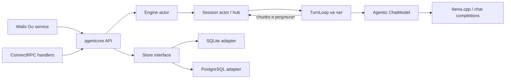

# Core: разбор TurnLoop и варианты архитектуры

Дата проверки: 16 ноября 2026. База: `work`, commit `033d2b4779c63cf7d78f4d031059d324d0da1b2e`.
Ветка: `core/architecture-review`. Статус: анализ и предложение к реализации; runtime в этой ветке не изменён.

## Вывод

Рекомендуется самостоятельный Go-модуль `packages/agentcore`, один долгоживущий `TurnLoop` на активный чат и actor, который владеет состоянием сессии. Wails вызывает публичный API пакета непосредственно, сервер вызывает тот же API из ConnectRPC handlers. SQLite и PostgreSQL подключаются через небольшой интерфейс хранилища.

Приложенный пример нельзя переносить в проект без исправлений: он не компилируется, может зависнуть на подтверждении `Push`, содержит гонки жизненного цикла сессии и подписок, скрывает ошибки стрима. Описанная перед примером actor-архитектура в самом примере отсутствует.

В репозитории уже есть другая реализация. Она обеспечивает независимость run от клиентского соединения, идемпотентность и восстановление статусов после перезапуска, но не соответствует новым требованиям к очереди, reasoning, локальной SQLite и записи ответа только после окончания стрима. Эти различия — изменение объёма относительно прежнего плана Core, а не доказательство, что прежний план реализован неправильно.

Ближайший объём: только Go-ядро, модель, очередь, Stop, события и persistence. Frontend, tools, skills и sub-agents в него не входят.

## Что проверено в Eino и llama.cpp

На дату проверки последний опубликованный стабильный Eino — [v0.9.23](https://github.com/cloudwego/eino/releases/tag/v0.9.23). В проекте закреплён v0.9.22. API ниже проверены по исходникам v0.9.23; `agenticopenai` — по commit `fa3cb9b7ad6a3496d4339b60d3df87bd173ad3ee` репозитория eino-ext. Обновление зависимостей в эту ветку не включено.

| API | Фактическое поведение и следствие |
|---|---|
| `Run(ctx)` | Сам запускает фоновую горутину и сразу возвращает. Дополнительный `go loop.Run(ctx)` не требуется. Повторный `Run` не перезапускает завершённый loop. |
| `Push(item)` | Возвращает `(accepted bool, ack <-chan struct{})`. Обычная постановка возвращает `nil` в `ack`. Результат `accepted` необходимо обрабатывать. |
| `WithPushStrategy` | Стратегия, вернувшая `nil`, делает обычный push. Даже вызов с `preempt=true` на уровне приложения поэтому может получить `nil` в `ack`. |
| Подтверждение preempt | Закрытие `ack` означает разрешение запроса отмены, в том числе no-op, если целевой ход уже закончился. Оно не подтверждает завершение стрима, записи в БД или нового хода. |
| `AnySafePoint` | Это `AfterChatModel \| AfterToolCalls`, а не немедленное прекращение текущей генерации. `WithPreemptTimeout` может перейти к немедленной отмене по таймауту. |
| `GenInput` | Получает все накопленные items; приложение выбирает `Consumed` и `Remaining`. FIFO по одному сообщению задаёт само приложение. |
| `RunCtx` | Должен происходить от `ctx`, переданного в `GenInput`. Им можно управлять временем жизни отдельного хода. |
| `OnAgentEvents` | Ненулевая ошибка callback завершает весь loop. Обычную ошибку модели нельзя бездумно превращать в фатальную ошибку сессии. `CancelError` не нужно возвращать: Eino обрабатывает его сам. |
| `Wait()` | Возвращает `TurnLoopExitState`: причину завершения, необработанные items и сведения о checkpoint. Нужен наблюдатель выхода loop. |
| `Stop(...)` | Завершает весь TurnLoop. Для кнопки остановки одного ответа при сохранении сессии нужен отдельный контракт отмены хода. |

Основание: [TurnLoop v0.9.23](https://github.com/cloudwego/eino/blob/v0.9.23/adk/turn_loop.go), [официальный Quick Start](https://www.cloudwego.io/docs/eino/core_modules/eino_adk/agent_cancel_and_turnloop_quickstart/).

Официальный [пример chatwitheino](https://github.com/cloudwego/eino-examples/blob/00ad7425513ff231b7467e88f5eeecde3c440bed/quickstart/chatwitheino/server/server.go) использует один loop на сессию, выбирает первое query в `GenInput` и сохраняет предыдущие результаты до следующего хода. Однако его `OnAgentEvents` передаёт iterator HTTP handler и ожидает ответ handler. Для требования продолжать работу без клиента вычитывание и persistence должны принадлежать ядру.

Для llama.cpp подходит `agenticopenai.NewChatModel` с `ChatConfig`, `BaseURL` и `ExtraFields`: он реализует `model.AgenticModel`, сохраняя `*schema.AgenticMessage`. Переход к Chat Completions не требует перехода обратно к плоским сообщениям. [Реализация ChatModel](https://github.com/cloudwego/eino-ext/blob/fa3cb9b7ad6a3496d4339b60d3df87bd173ad3ee/components/model/agenticopenai/chat_model.go).

llama.cpp поддерживает `/v1/chat/completions`, `chat_template_kwargs.enable_thinking` и отдельное поле `reasoning_content`. Формат выдачи reasoning зависит от настроек и шаблона конкретной сборки. ACL Eino преобразует reasoning в соответствующие content blocks. [llama-server](https://github.com/ggml-org/llama.cpp/blob/master/tools/server/README.md), [преобразование сообщений Eino](https://github.com/cloudwego/eino-ext/blob/fa3cb9b7ad6a3496d4339b60d3df87bd173ad3ee/libs/acl/openai/agentic_convert.go).

## Ошибки именно в приложенном примере

Имена `Session`, `HistoryStore`, `emit` в этом разделе относятся к вставленному тексту, а не к текущим файлам репозитория.

| Приоритет | Место | Проблема | Исправление |
|---|---|---|---|
| P0 | `Session.loop`, `newSession` | Поле имеет тип `atomic.Pointer[TurnLoop]`, но ему присваивается `*TurnLoop`; затем вызываются отсутствующие у `atomic.Pointer` методы `Run/Push/Stop/Wait`. Код не собирается. | Создать loop один раз до публикации сессии; хранить обычный `*adk.TurnLoop[...]`. |
| P1 | `Session.Send` | `<-ack` зависает навсегда при `nil`: стратегия возвращает `nil`, когда активного turn ещё нет; rejected push тоже может вернуть `nil`. | Проверить `accepted`; ожидать только ненулевой `ack` с ограничением через контекст вызывающего. Для быстрого Send ожидание preempt вообще необязательно. |
| P1 | `Engine.getOrCreate` | Конструктор запускает loop до `LoadOrStore`. Два параллельных запроса создают два работающих loop; проигравший не останавливается. | Создание и регистрация принадлежат одному actor менеджера; вернуть существующую сессию до создания новой. |
| P1 | `emit`, `Subscribe`, `Shutdown` | Между чтением snapshot и регистрацией подписки теряются события. Параллельное закрытие канала и отправка в него могут вызвать `send on closed channel`, даже внутри `select ... default`. | Snapshot, регистрация, отправка, удаление и закрытие подписки выполняются только hub-актором. |
| P1 | `OnAgentEvents`, `MessageStream.Recv` | Любая ошибка чтения превращается в обычный `break`; частичный ответ сохраняется как обычный. Ошибка `ConcatAgenticMessages` игнорируется. | Различать EOF, отмену, сбой провайдера и ошибку сборки. Сохранить частичный результат с соответствующим статусом; финализацию проверять. |
| P1 | Ошибка callback / loop | После `return ev.Err` TurnLoop завершается, но Engine хранит сессию и продолжает отвечать успешным Send без проверки `Push`. | Следить за `Wait`, переводить сессию в явное состояние ошибки; восстанавливать loop с обработкой неисполненных команд либо возвращать ошибку. |
| P1 | `HistoryStore.Load/Append` | Нельзя атомарно сохранить результат, статус хода и обработку команды. Нет ID для безопасного повтора. | Хранилище с операциями принятия команды, начала и финализации хода, транзакциями и идемпотентностью. |
| P1 | `GenInput` | Цикл записывает все `items`, затем `Consumed: items` объединяет накопившиеся запросы в один ход. Указанный в требованиях FIFO отсутствует. | Потреблять один item, остальные вернуть в `Remaining`; сообщения ещё не начатых ходов не добавлять в контекст модели. |
| P2 | `Subscribe`, `inFlight` | Архив завершённых ходов не воспроизводится. `EventTurnStart` сбрасывает буфер, хотя user-event отправлен раньше; при `EventTurnEnd` всё стирается. | Snapshot содержит историю/её страницу, текущий ход и очередь; события используют стабильные ID. |
| P2 | `emit` и watcher preempt | `emit` вызывается из нескольких горутин, хотя комментарий обещает одного писателя. `Load` → копирование → `Store` не является атомарным обновлением; возможны потерянные изменения и поздний preempt-event. | Watcher отправляет команду hub с `turnID`; hub проверяет текущий ход и задаёт порядок событий. |
| P2 | Переполненный канал подписчика | `default` молча теряет дельты. Клиент не может обнаружить пробел: номера события нет. | Ограниченная очередь; при переполнении отключить подписчика и потребовать новый snapshot, либо отправлять заменяющие snapshots. |
| P2 | Жизненный цикл | `bgCtx` не записан в поле, `loopOnce` не используется, отмена планируемого хода очищается только в `OnAgentEvents`, Shutdown конкурирует с созданием сессии. | Явные состояния Engine/Session, отмена и cleanup для ошибок до запуска агента; запрет Send после начала shutdown. |
| P2 | Память и persistence | Частое копирование всего накопленного текста даёт квадратичную работу; история растёт без границ; `MemoryStore` копирует указатели, но не сообщения. `WithoutCancel` убирает deadline у записи. | Builder/буфер блоков, ограничение контекста и истории в памяти, независимые snapshots; финализация с отдельным ограниченным контекстом. |

Утверждение «никаких мьютексов» в описании не соответствует примеру (`sync.Map`, `sync.Once`, `RWMutex`). Даже actor-приложение не будет строго lock-free: TurnLoop сам использует mutex/condition variable, как и драйверы БД. Разумное требование — единственный владелец изменяемого состояния ядра и отсутствие пользовательских mutex для этого состояния. [turn_buffer.go](https://github.com/cloudwego/eino/blob/v0.9.23/adk/turn_buffer.go).

## Что отличается в существующем Core

| Требование | Состояние в `work` | Необходимое изменение |
|---|---|---|
| Генерация продолжается без клиента | Уже есть: `Service.StartRun` создаёт контекст от `s.ctx`; `WatchRun` только читает состояние. | Сохранить это свойство при переносе; request context действует на приём команды/подписку. |
| Долгоживущий TurnLoop и уточнения в очереди | `engine.Generate` создаёт loop на один run и останавливает его. `StartRun` возвращает `ErrBusy`, `Store.Start` — конфликт при активном run. | Одна runtime-сессия на чат; durable queued command и обычный Push для уточнения. |
| Блочные сообщения и reasoning | `ModelMessage` содержит только `Role/Content`, используется `*schema.Message`; `completionChunk` читает только `delta.content` и tools. | `AgenticMessage`/версионированный payload; события и сохранение reasoning отдельно от видимого текста. |
| Запись assistant после окончания стрима | Callback в `Service.execute` вызывает `SaveRun` на каждой дельте. `WatchRun` получает эти snapshots из PostgreSQL polling. | Live-состояние хранится в hub; финальная запись — после EOF/прерывания. Одной заменой callback это не исправить: нужно изменить источник live-подписки. |
| Общий core для Wails и server | Реализация находится в `apps_back/server/internal`, Service зависит от `*chat.Store`, Store — от `pgxpool`. | Вынести reusable-модуль и порт Store; Wails/Connect и SQL-адаптеры оставить за его границей. |
| Локальная SQLite | Есть только PostgreSQL и PostgreSQL-специфичная миграция. | Отдельный SQLite-адаптер и миграции; общие contract tests для двух реализаций. |
| Одна подписка на всю сессию | `WatchRun` привязан к отдельному run, завершается с ним. | Новый session-stream API с snapshot + текущим ходом + очередью. Старый RPC можно временно сохранить адаптером. |

Проверенные файлы: [Service](../apps_back/server/internal/agent/service.go), [граница Engine](../apps_back/server/internal/agent/engine.go), [TurnLoop adapter](../apps_back/server/internal/agent/engine/engine.go), [llama.cpp adapter](../apps_back/server/internal/agent/engine/llama.go), [Store](../apps_back/server/internal/chat/store.go), [WatchRun](../apps_back/server/internal/rpc/handler.go), [proto](../proto/nprojects/v1/core.proto).

Отдельные исправления текущей реализации, которые нужно учесть при переносе:

- `Service.Close` не ставит состояние closing: новый `StartRun` может быть принят после начала завершения. Actor должен сериализовать закрытие и приём команд.
- `SaveRun` при `old.Status == cancelling` защищает только переход к `succeeded`, но промежуточный `r.Status == running` способен вернуть статус из `cancelling` в `running`. Переходы статусов должны быть монотонными и проверяться хранилищем.
- `Recover` применяется ко всем активным runs при запуске процесса. Это допустимо только для одного владельца исполнения; второй сервер не должен объявлять чужие живые runs прерванными. HA/leases не входят в ближайший объём.
- Прежний план описывает listener + snapshot для `WatchRun`, а код использует DB polling. При обновлении плана описывать фактический механизм.

## Варианты архитектуры

| Вариант | Устройство | Когда выбирать | Цена |
|---|---|---|---|
| A. Общий пакет, короткие mutex | Менеджер сессий под небольшим lock; у каждой сессии TurnLoop и синхронизированный hub. | Если главное — минимальное изменение нынешнего server и нет требования actor. | Нужно особенно внимательно проверять snapshot/subscribe/close; не соответствует пожеланию одного владельца состояния. |
| B. Общий пакет, actor на сессию | Engine actor владеет map сессий. Session actor владеет текущим ходом, подписками, revision и очередью; TurnLoop выполняет ходы. | Рекомендуется для заявленных требований и обоих способов запуска. | Нужны явные сообщения actor, подтверждения и правила shutdown; нельзя блокировать actor чтением стрима или ожиданием loop. |
| C. Общий пакет внутри sidecar | Тот же runtime работает в отдельном бинарнике; desktop общается по ConnectRPC или stdio. | Когда нужна изоляция процесса или отдельная фоновая служба. | Packaging и управление процессом. Если sidecar завершается вместе с Wails, задача тоже останавливается; само отделение процесса этого не решает. |

Варианты B и C совместимы: sidecar впоследствии может использовать тот же пакет без смены модели сессии.



## Рекомендуемая структура пакетов

```text
packages/agentcore/             самостоятельный Go-модуль
  engine.go                    публичный API и менеджер сессий
  session.go                   actor, подписки, отмена и очередь
  turnloop.go                  callbacks Eino и вычитка streams
  types.go                     команды, события, snapshot, результат
  store.go                     интерфейс persistence и его контракты
  llama.go                     фабрика AgenticModel
  go.mod
apps/desktop/internal/agent/   Wails-адаптер и SQLite Store
apps_back/server/internal/agent/ серверный адаптер ядра
apps_back/server/internal/chat/  PostgreSQL Store
migrations/                    SQL-миграции, запускаемые через mise
```

В корне не появляются `go.mod`, `go.work` или локальные `replace`. Пакет подключается по опубликованной версии модуля `github.com/Pheodaron/n-projects/packages/agentcore`; для версии используется тег вида `packages/agentcore/v0.1.0`. Сначала публикуется модуль, затем приложения меняют зависимость. Это сохраняет независимые build contexts. Операции пакета и проверок оформляются в его `mise.toml`; SQL-миграции остаются под корневым управлением. Не нужно одновременно создавать несколько библиотек для runtime, модели и событий.

Публичный API ядра не импортирует Wails, Connect или pgx. Типы Eino допустимы в model-порте и кодеке сообщений; транспорт получает собственные DTO. Небольшой Store объявляется у потребителя в core; реализации остаются в приложениях.

## Контракты исполнения и хранения

Ниже эскизы контрактов, не готовая компилируемая реализация. Типы результатов и ошибок должны быть определены при реализации.

```go
type Core interface {
    Send(ctx context.Context, cmd Command) (Receipt, error)
    CancelTurn(ctx context.Context, sessionID, turnID string) error
    Subscribe(ctx context.Context, sessionID string) (Subscription, error)
    Shutdown(ctx context.Context) error
}

type Store interface {
    // Повтор requestID с тем же payload возвращает прежний Receipt.
    // Другой payload с тем же requestID — конфликт.
    AcceptCommand(context.Context, Command) (Receipt, error)
    LoadSession(context.Context, string) (StoredSession, error)
    BeginTurn(context.Context, BeginTurn) (Turn, error)
    FinalizeTurn(context.Context, TurnResult) error
}
```

Ключи сессий в серверном адаптере включают владельца/workspace; проверки доступа сохраняются до обращения к core. Request ID и ключ идемпотентности не должны пересекаться между владельцами. История и commands хранятся раздельно: durable постановка уточнения ещё не означает, что оно уже участвует в текущем prompt.

1. `Send` валидирует команду и атомарно сохраняет её как `queued` до успешного Receipt. Повтор не ставит её в очередь ещё раз. Размер очереди ограничен; переполнение — явная ошибка до приёма.
2. После commit команда передаётся в TurnLoop. Если `Push` отверг её, actor обрабатывает выход loop, а команда остаётся в БД для восстановления/явного завершения. Нельзя выдавать ложный успех и терять её.
3. `GenInput` выбирает одну команду. `BeginTurn` атомарно связывает команду, новый turn и user-message. История включает ранее законченные ходы и выбранный запрос, без будущих queued-запросов.
4. Ядро вычитывает stream независимо от подписчиков. Text и reasoning дельты обновляют live-проекцию hub и уходят подписчикам. SQL на каждый токен не нужен.
5. После окончания stream сообщения собираются через `ConcatAgenticMessages`. `FinalizeTurn` одной транзакцией сохраняет полные content blocks, статус и связь с обработанной командой. Повтор финализации безопасен; конфликтующий результат отклоняется.
6. Только после commit ядро объявляет ход сохранённым/завершённым и разрешает следующий. При ошибке БД оно сохраняет pending-result в памяти, сообщает об ошибке persistence и приостанавливает дальнейшие ходы; успех не имитируется.

Статусы: `queued → running → succeeded | cancelled | preempted | failed | interrupted`. Для асинхронного Stop возможен промежуточный `cancelling`. EOF ещё не означает успех: нужно проверить finish reason, ошибки iterator/concat и commit. Достижение лимита вывода должно иметь явный исход; в текущем адаптере это `ErrOutputLimit`.

SQLite и PostgreSQL реализуют одинаковые транзакционные гарантии и порядок сообщений, но используют собственный SQL. JSONB и advisory locks текущего PostgreSQL Store нельзя переносить в SQLite. На первом этапе достаточно хранить версионированный JSON payload сообщения с отдельными ID, порядком и статусом; SQL-запросы по каждому content block пока не требуются. Metadata с полями `any` требует проверки round-trip кодека: JSON не сохраняет произвольные Go-типы автоматически.

Размышления сохраняются как reasoning blocks вместе с assistant-message после окончания stream. Для будущих tools каждый завершённый шаг сохраняется по окончании своего сообщения/вызова; схема не должна предполагать ровно один assistant-message навсегда. Сейчас выполнение tools не добавляется.

**Ограничение выбранной политики записи:** отключение подписчика не теряет ответ, пока жив процесс. Падение процесса до финализации теряет несохранённые дельты. На старте такой ход получает `interrupted`; queued-команды восстанавливаются, но незаконченный ответ автоматически не продолжается. Если нужно сохранять промежуточный текст при аварии, это отдельная политика периодических checkpoints; она меняет требование «запись после окончания stream».

## FIFO, уточнение, preempt и Stop

Обычное уточнение ставится в очередь следующего хода; оно не меняет prompt уже выполняющегося LLM-вызова. Для изменения задачи сейчас нужен явный preempt: текущий результат финализируется с соответствующим статусом, затем начинается новый ход.

Минимальная часть результата `GenInput` для FIFO:

```go
return &adk.GenInputResult[*Command, *schema.AgenticMessage]{
    RunCtx: turnCtx, // context.WithCancelCause(ctx), созданный для этого хода
    Input: &adk.TypedAgentInput[*schema.AgenticMessage]{
        Messages: historyWithSelectedCommand,
        EnableStreaming: true,
    },
    Consumed: items[:1],
    Remaining: items[1:],
}, nil
```

Проверка непустого `items`, транзакция начала хода и регистрация cancel в actor выполняются до этого фрагмента. Отмена очищается также при ошибке `PrepareAgent` и при выходе loop, а не только в `OnAgentEvents`.

Для safe-point preempt достаточно прямого API, условная стратегия здесь не нужна:

```go
accepted, ack := loop.Push(cmd,
    adk.WithPreemptTimeout[*Command, *schema.AgenticMessage](
        adk.AnySafePoint, 2*time.Second,
    ),
)
if !accepted {
    return ErrLoopClosed
}
// Необязательное ожидание наблюдения запроса; это не ожидание нового ответа.
if ack != nil {
    select {
    case <-ack:
    case <-requestCtx.Done():
        return requestCtx.Err()
    }
}
```

Preempt не переставляет item перед уже накопленными items. В начальном варианте очередь остаётся FIFO: если B и C уже ожидают, новый preempt D отменит A, затем выполнятся B, C, D. Это поведение нужно сделать явным. Сценарий «D заменяет все уточнения» требует отдельной атомарной операции отмены queued-команд, а не только опции Push.

Кнопка Stop вызывает `CancelTurn(sessionID, expectedTurnID)`: actor отменяет только совпадающий активный ход через его `RunCtx`; stale-команда не задевает следующий ход. Частичный ответ сохраняется со статусом cancelled, loop продолжает жить. Очередь по умолчанию сохраняется и продолжает выполняться. Остановка всей очереди или пауза сессии — отдельная команда, если понадобится продукту.

`loop.Stop(WithGracefulTimeout(...))` применяется при удалении/выгрузке сессии и Shutdown. Сначала ядро закрывает приём команд, затем завершает loops и bounded finalization, после этого закрывает подписки и БД. Сигнал завершения приложения не должен преждевременно отменять контекст записи результата. В `Shutdown` нужен deadline; actor не должен выполнять `loop.Wait()` внутри своего select.

## Reconnect и владение состоянием

Session actor владеет subscribers, текущим turn, его блоками, статусами и монотонным `seq`. Все обращения из callback и cancel-watcher проходят через его mailbox. Сам stream reader работает отдельно: заблокированный `Recv` не должен мешать подписке или Stop. Нельзя ждать preempt-ack внутри actor, если завершение хода ждёт ответа этого же actor.

При обработке Subscribe actor в одной последовательности регистрирует подписчика и ставит ему `snapshot(seq=S)`: завершённые сообщения выбранной страницы истории, текущий полный текст/reasoning, очередь и статусы. Следующие сообщения имеют `seq > S`. История до страницы доступна отдельным чтением Store; весь архив не держится в RAM и не отправляется заново при каждом токене.

Каждое сообщение события содержит `sessionID`, `turnID`, `messageID`, `seq` и, для дельт, идентификатор блока. Snapshot заменяет состояние клиента; delta применяется только один раз после его границы. Завершённый результат заменяет ту же сущность по `messageID`, поэтому in-flight текст не дублируется как новое сообщение.

При переполнении bounded очереди медленный подписчик отключается и получает свежий snapshot при reconnect; silent drop токенов запрещён. Снятие подписки закрывает только канал клиента. Генерация, очередь и сохранение продолжаются без подписчиков. Закрывает каналы только hub.

Холодное чтение истории выполняется до готовности session actor либо отдельным I/O worker; загрузка всей истории одного чата не блокирует глобальный Engine actor. Завершённая история читается страницами, контекст модели ограничивается отдельно. Автоматическое добавление всех сохранённых reasoning в следующий prompt не требуется: это политика адаптера модели, зависящая от Qwen-шаблона.

## Последовательность реализации

1. Закрепить контракты Send/Receipt, CancelTurn, snapshot и Store; согласовать новый объём с прежним планом Core. Использовать actor-вариант B без строгого обещания lock-free.
2. Выделить модуль и подключить `agenticopenai.NewChatModel`; сохранить bounded HTTP/turn timeouts и проверку endpoint. Проверить text + reasoning через управляемый HTTP provider и реальный llama.cpp.
3. Реализовать session runtime: один loop, FIFO, отмену по turnID, наблюдение `Wait`, независимый stream reader, bounded подписки и shutdown. Для тестов — Store без SQL с теми же гарантиями.
4. Добавить PostgreSQL и SQLite Store, транзакции и идемпотентность; SQL-миграции и команды через mise. Сохранить серверное владение ресурсами и проверки доступа.
5. Перевести server на общий API; добавить Go-адаптер Wails для локального исполнения. Frontend в этот этап не входит. Обновлять proto/generate только при подключении нового session-stream RPC.
6. Опубликовать версию модуля и переключить зависимости приложений без `replace`; обновить архитектуру и план под фактический результат. При изменении env-контракта документировать его только в `.env.example`.

Не переносить текущий SQL-per-delta polling вместе с новой финализацией: иначе live-ответ пропадёт до конца генерации. Не подключать tools/skills/sub-agents «заодно» с переносом.

## Проверки перед принятием реализации

| Сценарий | Ожидаемый результат |
|---|---|
| Два одновременных Send в новый чат | Один Session/TurnLoop, два однозначно упорядоченных принятых запроса. |
| Отключение всех клиентов посреди stream | Стрим вычитывается до конца, результат сохранён, новый Subscribe получает его. |
| Subscribe одновременно с delta/финализацией | Нет пропуска, двойного добавления или смешения snapshot и следующих событий. |
| B/C поступают во время A | Следующие ходы выполняются FIFO, контекст A не содержит B/C. |
| Повтор requestID | Та же Receipt, единственный user-message и ход; другой payload вызывает конфликт. |
| Preempt в idle/planning/active и rejected Push | Нет ожидания nil-канала; подтверждение запроса не объявляется завершённым ходом. |
| Stop(A) приходит после начала B | B продолжает работу; очереди и подписки живы. |
| EOF / stream error / cancellation / output limit | Разные исходы; частичный ответ не становится succeeded. Reasoning и text сохраняются без смешения. |
| Ошибка concat или БД при финализации | Нет ложного turn-completed, повтор безопасен, следующий ход не читает неполную историю. |
| Медленный subscriber | Ограниченная память, явный reconnect, модель не блокируется сетью клиента. |
| Restart / shutdown одновременно с Send | Непринятое возвращает ошибку; принятое остаётся в durable очереди либо имеет завершённый статус. |
| SQLite и PostgreSQL | Один набор contract tests проверяет транзакции, порядок, идемпотентность и round-trip content blocks. |

Для concurrency-изменений обязателен `go test -race` через mise, для адаптеров — интеграционные проверки с соответствующей БД. Тесты должны проверять эти наблюдаемые гарантии, а не копировать внутренние шаги actor.

В этой ветке выполнена проверка исходников API и статический разбор репозитория. Go-код не менялся; сборка, race-тесты, SQL-тесты и вызов реального llama.cpp не выполнялись. Приведённые фрагменты — иллюстрации будущей реализации.
